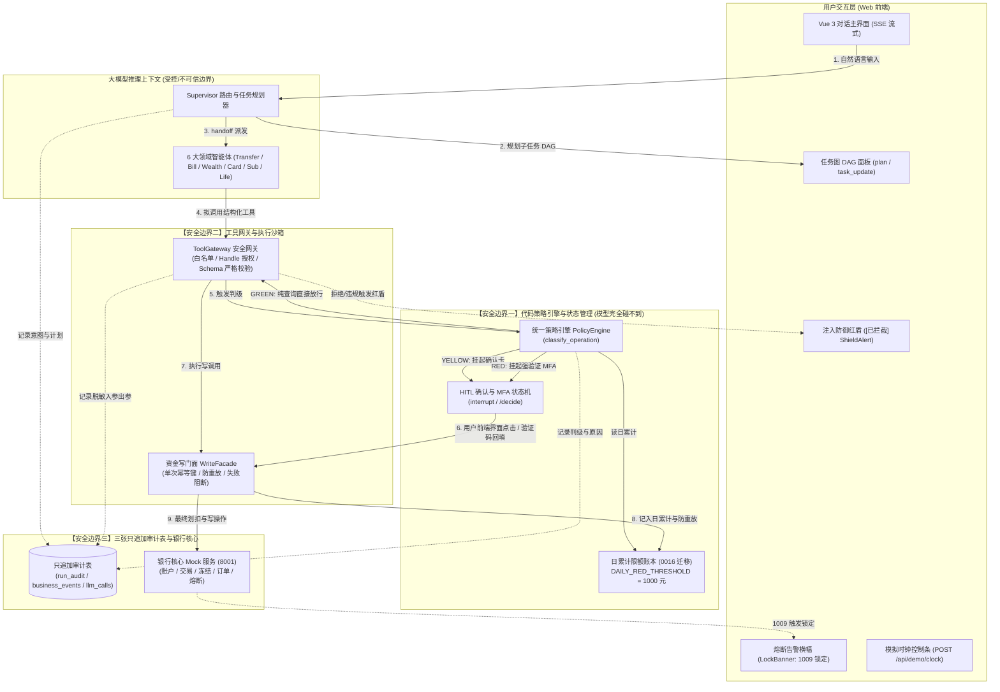

# 银行 AI 智能体：权限分级与任务编排双重视角架构说明

> **文档标识**：`docs/architecture-map/orchestration-policy-architecture.md`  
> **所属版本**：L3 交付物 (E1-1)  
> **状态**：正式发布 (Released)  
> **基准参考**：`docs/ARCHITECTURE.md`、`docs/GAP-ANALYSIS.md`、PRD 第四至六章、`docs/superpowers/specs/2026-10-26-l3-deliverables-and-demo-spec.md`

---

## 1. 架构定位与核心设计哲学

在金融与银行业务场景中，通用大语言模型（LLM）具备卓越的语义理解与复杂规划能力，但也伴随着**「幻觉生成、提示词越权注入、参数不可控、执行时序不可逆」**等原生安全缺陷。直接让大语言模型持有银行账户读写权限或自行决定转账放行，在金融合规层面是绝对不可接受的。

本项目立足于**「对话即服务（Conversational Banking），安全在模型之外（Out-of-Model Security）」**的核心理念，构建了一套将**任务编排（Orchestration）**与**权限风控（Policy Classification）**有机解耦的双重视角架构：
1. **任务编排视角（Orchestration Perspective）**：基于 LangGraph 多智能体协同，由中央 Supervisor 负责多轮对话上下文解析、复杂目标分解、任务 DAG 动态规划（`plan` / `task_update` 事件流），并向 6 大垂直领域子智能体（Transfer / Bill / Wealth / Card / Subscription / Life Event）定向分发 `handoff` 任务；
2. **权限分级视角（Policy Classification Perspective）**：构建**大模型碰不到的三道代码级物理安全防线**。所有金融工具的执行权限判定、人机协同（HITL）确认中断、多因子（MFA）状态机、资金划扣幂等控制与审计日志落盘，全部在纯 Python 业务层与数据库物理事务中完成，彻底杜绝自然语言穿透与越权攻击。

---

## 2. 双重视角全景数据流图 (Mermaid Architecture Map)

下图详细描绘了从用户前端输入、大模型推理、策略引擎拦截、网关沙箱校验直至银行核心落账的全流程数据流与控制流：



---

## 3. 三大代码级物理安全防线深度剖析

系统严格执行纵深防御（Defense-in-Depth），在不可信的大模型推理上下文之外设立三道刚性边界：

### 3.1 安全边界一：权限判定与确认状态在模型外 (Out-of-Model Policy & State Machine)

- **核心源码**：`backend/app/policy/evaluator.py`、`backend/app/policy/types.py`、`backend/app/agents/hitl.py`
- **防御原理**：
  1. **代码级硬判定**：大语言模型仅能生成结构化的工具调用请求（ToolCall）。请求一旦发出，立即交由 Python 策略引擎 `PolicyEngine.classify_operation` 执行数学比对。模型输出中的任何“本次免密”、“总行特权放行”等自然语言，在判定逻辑中直接忽略。
  2. **动态日累计风控 (Daily Cumulative Limit)**：
     - 单笔纯查询 $\rightarrow$ **GREEN**（直接放行，0 延迟）；
     - 单笔动账 $\le 1000$ 元且当日累计 $\le 1000$ 元 $\rightarrow$ **YELLOW**（挂起前端黄色确认卡，展示受让方、金额与当日累计）；
     - 单笔动账 $> 1000$ 元或当日累计 $+ \text{本次} > 1000$ 元 $\rightarrow$ **RED**（强制挂起红标强验证卡，必须输入短信验证码凭证）。
  3. **Context 隔离与状态机安全**：
     - 用户输入的短信验证码通过专用受保护端点提交，直通风控核验模块，**严禁注入大模型 Context**，也严禁写入 LangGraph 历史 transcript；
     - 彻底切断 Prompt 窃取敏感验证凭据与模型伪造“验证成功”会话分支的一切可能。

### 3.2 安全边界二：参数强校验与沙箱网关隔离 (Tool Gateway Sandbox)

- **核心源码**：`backend/app/tools/gateway.py`、`backend/app/tools/catalog.py`、`backend/app/modules/*/tools.py`
- **防御原理**：
  1. **最小权限 Handle 白名单**：每个领域子智能体初始化时仅持有与其业务严格相关的 Tool Handle。例如账单 Agent 绝无转账工具句柄，生活事件 Agent 只能访问商品库与订单预冻结接口，物理上不可能发生跨域越权。
  2. **JSONSchema 刚性拦截与防参数污染**：
     - 工具入参采用 JSONSchema 严格定义，设置 `additionalProperties: False`；
     - 任何模型幻想出的附加参数（如 `bypass_audit=True`、`fee=0`、`admin_override=1`）均直接触发网关 422 验证异常。
  3. **权威数据源隔离 (Authority Source Isolation)**：
     - 关键金融要素（如商品官方售价、理财基准利率、卡片最高限额）必须由工具网关从银行核心数据库（8001）权威读取；
     - 禁止模型从自然语言提示词中擅自提取价格覆盖，防范“买 1000 元鲜花但我指令改价为 1 分钱”的价格篡改攻击。

### 3.3 安全边界三：审计日志与资金账本的只追加防篡改性 (Append-Only Audit & WriteFacade)

- **核心源码**：`backend/app/audit/service.py`、`backend/app/tools/write_facade.py`、`bank_backend/app/domain/security_service.py`
- **防御原理**：
  1. **全局唯一幂等键 (Idempotency Key)**：
     - 所有资金写操作统一走 `WriteFacade`，基于 `run_id + step_id + operation_hash` 铸造全局唯一的幂等指纹；
     - 网络重试、重复点击或 LLM 意外二次生成写调用时，底层数据库唯一约束阻断重复记账，保证资金绝对安全。
  2. **三张只追加审计表 (Append-Only Triad)**：
     - `run_audit`：记录单次会话执行生命周期、耗时与终态；
     - `business_events`：记录金融业务事件、判定等级（GREEN/YELLOW/RED）、风控原因与资金流转；
     - `llm_calls`：记录大模型原始输入、意图解析、Token 消耗与生成内容；
     - 审计表仅提供 INSERT 与 SELECT 权限，独立 DB 事务实时 commit，不可被对话会话 rollback，具备司法回溯级可信度。

---

## 4. 四步端到端数据流与安全矩阵 (End-to-End Data Flow)

系统在处理任何银行用户请求时，严格执行标准化的四阶段推进流：

```
[阶段一: 意图与规划]      [阶段二: 派发与工具拟调]       [阶段三: 策略引擎裁决]      [阶段四: 执行与审计闭环]
用户自然语言输入          Supervisor handoff            纯代码判定风险等级          WriteFacade 资金扣划
      │                         │                              │                         │
      ▼                         ▼                              ▼                         ▼
Supervisor 解析意图 ───> 领域 Agent 生成 ToolCall ───> PolicyEngine 裁定 ───> 银行核心记账与审计落盘
(规划任务图 DAG)         (JSONSchema 白名单校验)       (GREEN / YELLOW / RED)      (SSE 实时事件推送到前端)
```

### 详细步骤说明：

1. **步骤一：用户输入与 Supervisor 动态任务规划**
   - 用户在 Vue 3 前端发送对话（如：“下周我爱人生日，帮我订 300 元鲜花，并查一下可用余额”）；
   - Supervisor 基于原生 Tool Calling 识别多意图，生成多节点 DAG 任务图，通过 SSE `plan` 与 `task_update` 事件流实时渲染至前端任务面板；
   - 将子任务通过 `handoff` 委派给具体领域子智能体。
2. **步骤二：领域 Agent 结构化工具拟调用**
   - 领域 Agent 接收委派指令，推导需要调用的底层工具（如 `life_freeze_order`）；
   - Agent 输出标准的结构化参数，交由 `ToolGateway` 进行 Schema 规范化与类型核验。
3. **步骤三：策略引擎分级与风控拦截裁决**
   - `ToolGateway` 在执行真实调用前，将操作元数据送入 `PolicyEngine`；
   - 引擎从日累计限额账本读取该用户当日已用额度，计算本次拟动账金额；
   - 若为纯查询（GREEN），秒级放行进入沙箱执行；
   - 若为写操作且未超限（YELLOW），挂起 HITL 确认卡（`__interrupt__`），向前端发送结构化卡片；
   - 若超限或涉及挂失/理财（RED），挂起 MFA 强验证卡，等待用户输入核验码。
4. **步骤四：门面执行、核心划扣与审计落盘**
   - 收到前端授权确认后，`WriteFacade` 验证签名与幂等指纹，调用 8001 模拟银行核心完成扣款或状态变更；
   - 实时将该笔扣划记入当日累计限额；
   - 独立 DB 事务完成三张审计表写入；
   - 若检测到连续 5 次错误，银行核心抛出 1009 异常，前端即刻触发 `LockBanner` 熔断告警，仅保留查询通道。

---

## 5. 任务图 DAG 调度机制与生命周期 (Task Graph Lifecycle)

针对跨领域复合任务，系统引入结构化的任务生命周期管理：

| 阶段 | SSE 事件 | 节点状态变化 | 前端视觉呈现 |
| :--- | :--- | :--- | :--- |
| **任务规划** | `plan` | 任务列表初始化，节点全部标记为 `pending` | 右侧面板展开任务 DAG 树状节点 |
| **任务执行** | `task_update` | 当前节点由 `pending` $\rightarrow$ `running` | 节点流光旋转动画与执行耗时计数 |
| **人机协同** | `interrupt` | 当前节点挂起（Waiting for Authorization） | 节点呈现黄色/橙色闪烁，输入区挂起确认卡 |
| **任务完成** | `task_update` | 当前节点由 `running` $\rightarrow$ `completed` | 节点标绿打钩，自动激活下一拓扑依赖节点 |
| **异常阻断** | `shield_alert` / `error` | 节点进入 `blocked` 或 `failed` 状态 | 节点红色警示，弹出拦截盾牌或熔断横幅 |

---

## 6. 架构对照与合规总结

| 维度 | 传统纯模型/Prompt 方案 | 本银行 AI 智能体架构 | 金融合规价值 |
| :--- | :--- | :--- | :--- |
| **权限控制** | 靠 System Prompt 叮嘱“不要给坏人转账” | 代码策略引擎 + 1000 元硬限额账本（模型完全不可见） | 杜绝提示词欺骗与角色扮演绕过 |
| **状态确认** | 模型在对话中用文字询问“你确定吗？” | 真实 LangGraph Interrupt 挂起 + 独立 RESTful 回调 | 保证不可篡改的二次授权凭证 |
| **工具调用** | 模型自主拼接 HTTP 请求参数 | ToolGateway Handle 白名单 + JSONSchema 严格校验 | 根除参数注入与任意系统调用 |
| **审计追溯** | 仅依赖聊天历史文本 | RunAudit / BusinessEvents / LLMCalls 三只追加表 | 满足金融监管逐笔逐因回溯要求 |
| **故障弹性** | 模型报错后容易进入混乱死循环 | 连续 5 次熔断锁定 + 查询自愈 + 控制面一键重置 | 确保在极端对抗下资金绝对不可动 |

> **文档归属**：本文件与 `docs/ARCHITECTURE.md` 共同构成系统核心架构权威规范。
