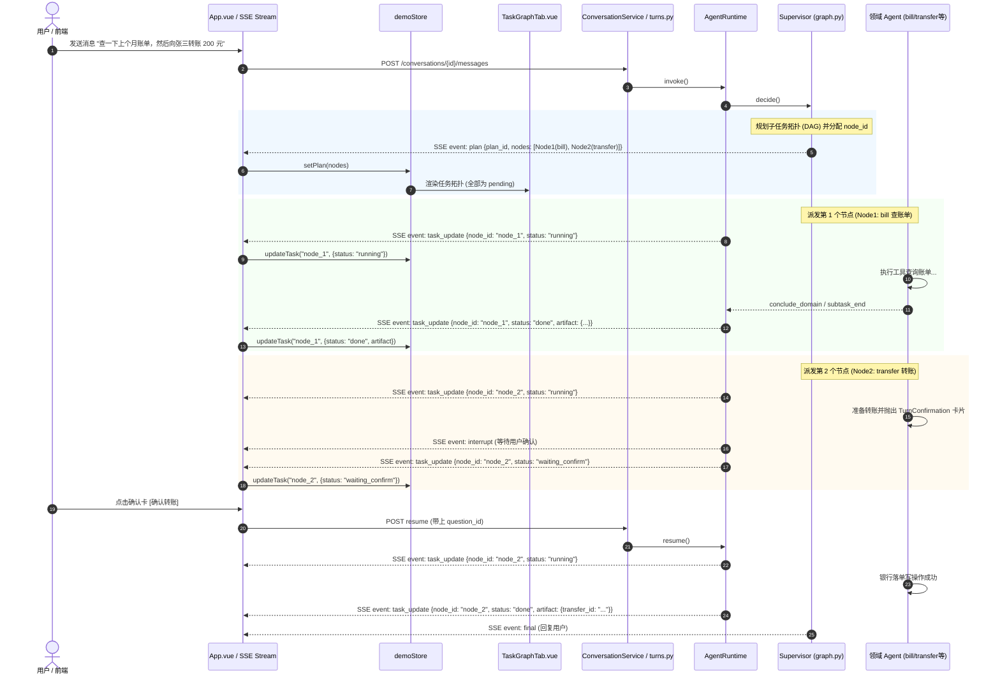

# 银行 AI 智能体：D2 任务图（后端 DAG 事件 + 前端第三个 Tab）规格说明书 (Spec)

> **文档标识**：`docs/superpowers/specs/2026-10-23-d2-task-graph-spec.md`  
> **制定日期**：2026-10-23  
> **状态**：已实现（2026-10-25；实施记录见 [实施计划](2026-10-23-d2-task-graph.md) 的「状态」节与 `.superpowers/sdd/2026-10-23-d2-task-graph/progress.md`）  
> **依据基准**：`docs/GAP-ANALYSIS.md`（§G4、§G7、§L2.D2）、`docs/superpowers/specs/2026-10-21-agent-foundation-and-l1-execution-spec.md`、`dev` 分支 `78b90d0`  
> **目标范围**：L2 收口主线中的 D2 任务（后端任务 DAG 建模、SSE `plan`/`task_update` 事件流转、Supervisor 任务链规划、节点状态追踪，以及前端抽屉第三个页签「任务图」`TaskGraphTab.vue` 完整视图）。

---

## 1. 背景与诉求 (Why)

### 1.1 现状与痛点
在 L1 阶段完成后，系统已具备统一策略引擎、日累计限额、模拟时钟控制台以及审计时间线面板。然而，在复杂任务编排与可观测性方面仍存在以下核心缺口：
1. **后端仅有简单线性 handoff 队列**：`pending_handoffs` 仅是简单的 `{agent_id, instruction}` 字典列表（`backend/app/agents/decisions.py`），无节点唯一 ID、无依赖关系、无显式状态机（pending/running/waiting_confirm/done/failed/skipped）、无前序节点产物槽位。
2. **缺乏任务全景可见性**：用户提出跨域请求（如“查账单并向某人转账”或“查余额后投资”）时，前端只能看到聊天流卡片与抽屉中的审计日志，无法直观感知任务整体拓扑、正在执行哪个子任务、前序产物如何流动。
3. **前端第三个 Tab 处于占位状态**：`frontend/src/DemoSidebar.vue` 中的第三个页签（`tab: 'tasks'`）目前仅显示硬编码静态文案 `<p class="demo-placeholder" data-test="panel-tasks">任务编排视图将在 L2 接入</p>`。

### 1.2 赛题与 PRD 评测硬要求
- **赛题标准**：“复杂任务先出子任务 DAG，支持中断/回退/人工接管”。
- **PRD 验收标准**：“演示界面必须同时展示任务图、当前节点、确认卡/MFA 卡、模拟时钟、完整审计链路”。

---

## 2. 目标、非目标与范围边界 (Scope & Non-Goals)

### 2.1 目标 (Goals)
1. **建立结构化 TaskNode 与 TaskPlan 契约**：在后端对任务拓扑与节点状态进行显式建模，支持依赖（`depends_on`）、责任智能体（`owner`）、执行状态与结构化产物槽位（`artifact`）。
2. **打通 SSE 任务事件通道**：
   - `plan`：Supervisor 在规划任务后，向客户端广播完整的任务 DAG 结构。
   - `task_update`：在任务节点启动、暂停等待确认（HITL/MFA）、完成或跳过时，实时向客户端推送状态流转与输出产物。
3. **基座层统一接管事件，领域零侵入**：
   - 所有的 `task_update` 状态流转（`running`、`waiting_confirm`、`done`、`skipped`）统一在基座层（`AgentRuntime` 与 `Supervisor`）自动拦截转换，**绝对不侵入改造具体的 6 个领域智能体**。
4. **交付前端「任务图」Tab 视图组件 (`TaskGraphTab.vue`)**：
   - 替换 `DemoSidebar.vue` 的占位文案，提供美观、直观的垂直拓扑图/时间线视图。
   - 展现节点状态（等待中/运行中/等待确认/已完成/已失败/已跳过）、当前高亮与结构化输出展开。
   - 在 `demoStore.ts` 集中管理任务图状态，不增加 `App.vue` 复杂度。

### 2.2 非目标与防蔓延边界 (Non-Goals & Anti-Goals)
- ❌ **本任务不包含实现 `life_event` 的真实业务工具**：`life_event` 智能体（G6）作为独立主线（需 3-4 人天开发银行生日接口与订单工具），不属于 D2 范围。D2 的多域测试与验收依托既有真实领域（如 `bill` + `transfer` 或单域转账加确认卡链路）。
- ❌ **不做运行时并发执行 DAG**：根据 ADR 裁决与单 worker + 进程内锁现状，任务图在执行层面严格保持**确定性串行调度**，依赖仅用于拓扑表达与前序输出传递，不做并发分支。
- ❌ **不推翻重构 Supervisor**：继续沿用原生 tool calling + 现有多域派发状态机，不引入 `langgraph-supervisor` 等外部第三方框架（roadmap A5 已裁决）。
- ❌ **不做动态图编辑/拖拽**：前端任务图仅作为执行过程的可视化监视器（Observer），不提供人工在线连线或增删节点的交互。
- ❌ **不修改 REST 数据库 schema**：任务图是面向演示与实时观测的展示流，状态保存在内存与 LangGraph 检查点中，不增加额外的持久化业务表。

---

## 3. 总体架构与数据流 (Architecture)



---

## 4. 后端详细设计 (Backend Specification)

### 4.1 任务图与节点核心数据模型 (`backend/app/agents/task_dag.py`)
新建独立数据定义模块 `backend/app/agents/task_dag.py`：

```python
"""任务 DAG 与节点状态定义。"""

from __future__ import annotations

from dataclasses import asdict, dataclass, field
from typing import Any, Literal

TaskNodeStatus = Literal[
    "pending",          # 等待执行
    "running",          # 正在执行
    "waiting_confirm",  # 暂停等待用户确认 (HITL / MFA)
    "done",             # 执行成功完成
    "failed",           # 执行失败
    "skipped",          # 因前序失败被跳过
]


@dataclass(frozen=True, slots=True)
class TaskNode:
    """DAG 中的单个任务节点。"""
    id: str                                  # 节点唯一标识，如 "node_1", "node_2"
    label: str                               # 节点展示名称，如 "查询账单与结余"
    owner: str                               # 所属智能体 agent_id，如 "bill", "transfer"
    depends_on: tuple[str, ...] = ()         # 前序依赖节点 id 列表
    status: TaskNodeStatus = "pending"       # 当前状态
    artifact: dict[str, Any] | None = None   # 节点输出的结构化结果摘要
    error: str | None = None                 # 失败原因（若有）

    def as_dict(self) -> dict[str, Any]:
        return {
            "id": self.id,
            "label": self.label,
            "owner": self.owner,
            "depends_on": list(self.depends_on),
            "status": self.status,
            "artifact": dict(self.artifact) if self.artifact else None,
            "error": self.error,
        }


@dataclass(frozen=True, slots=True)
class TaskPlan:
    """一轮对话中的完整任务图。"""
    plan_id: str
    nodes: tuple[TaskNode, ...] = ()

    def as_dict(self) -> dict[str, Any]:
        return {
            "plan_id": self.plan_id,
            "nodes": [node.as_dict() for node in self.nodes],
        }


def label_for_domain_task(agent_id: str, instruction: str) -> str:
    """为任务节点生成清晰、人类可读的中文标题。"""
    DOMAIN_NAME_MAP = {
        "bill": "账单查询与分析",
        "transfer": "资金转账办理",
        "card": "信用卡与账户管理",
        "wealth": "理财持仓与申赎",
        "subscription": "免密扣费管理",
        "life_event": "生活事件与备忘",
    }
    prefix = DOMAIN_NAME_MAP.get(agent_id, f"领域任务 ({agent_id})")
    clean_inst = (instruction or "").strip()
    if clean_inst:
        # 取简短前缀，不超过 20 字
        short_desc = clean_inst[:20] + ("…" if len(clean_inst) > 20 else "")
        return f"{prefix} · {short_desc}"
    return prefix
```

### 4.2 SSE 事件白名单与 Envelope 补齐 (`backend/app/agents/runtime.py` 与 `sse.py`)
1. **`backend/app/api/sse.py`**：
   `EVENT_NAMES` 集合中已经包含 `"plan"` 与 `"task_update"`，无需修改。
2. **`backend/app/agents/runtime.py`**：
   修改 `EVENT_FIELDS` 映射，增加两个事件的合法字段提取规则：
   ```python
   EVENT_FIELDS: dict[str, tuple[str, ...]] = {
       "agent_start": ("agent_id",),
       "tool_call": ("agent_id", "tool_name", "call_id", "arguments"),
       "tool_result": ("agent_id", "tool_name", "call_id", "status", "data", "error", "error_code"),
       "interrupt": ("kind", "question_id", "agent_id", "fields", "display", "attempt"),
       "subtask_end": ("agent_id", "status", "summary", "turn_status"),
       "reply_delta": ("text",),
       "narration": ("text",),
       "final": ("text", "business_ids", "terminal_reason", "error_status"),
       # D2 任务图事件：
       "plan": ("plan_id", "nodes"),
       "task_update": ("plan_id", "node_id", "status", "artifact", "error"),
   }
   ```

### 4.3 Supervisor 规划与 DAG 生成逻辑 (`backend/app/agents/supervisor/graph.py`)
1. **提示词规则优化 (`backend/app/agents/prompts.py`)**：
   调整 `SUPERVISOR_PROMPT` 中原有的“一次只交给一个领域 Agent”硬限制，改为：
   *“如果用户的请求包含多个阶段的明确复合目标（例如'先查账单，再转账'），你可以在一次回复中连续调用多个 handoff 工具按顺序派发，系统将自动将其构建为执行任务图并依次执行；若不需要多个领域，则只派发一个。”*
2. **构建 TaskPlan 与给 Queue 注入 `node_id`**：
   在 `decide()` 中，当识别到 1 个或多个 `handoffs` 时：
   - 构造 `plan_id = f"plan_{new_id()[:8]}"`
   - 为每个 handoff 分配节点：
     - `node_1`: `id="node_1"`, `label=label_for_domain_task(h1.agent_id, h1.instruction)`, `owner=h1.agent_id`, `depends_on=()`
     - `node_2`: `id="node_2"`, `label=label_for_domain_task(h2.agent_id, h2.instruction)`, `owner=h2.agent_id`, `depends_on=("node_1",)`
   - 将 `node_id` 注入到 `pending_handoffs` 队列元素中：
     `queued = [{"node_id": node.id, "agent_id": item.agent_id, "instruction": item.instruction} for ...]`
   - 立即通过 `writer({"event": "plan", "plan_id": plan_id, "nodes": [n.as_dict() for n in nodes]})` 广播下发整图。
3. **状态保留在 `AgentState`**：
   在 `backend/app/agents/state.py` 的 `AgentState` 中新增：
   - `task_plan: dict[str, Any] | None`
   - `active_task_node_id: str | None`
   使得在中断暂停、重连与多轮之间，任务图与当前活跃节点在检查点中完整保留。

### 4.4 基座统一派发 `task_update`（领域智能体零侵入）
**【关键架构裁决：基座层集中管理状态事件】**：
领域模块内部无需关心 `node_id` 和 `TaskPlan`，所有的 `task_update` 由基座统一派发：
1. **派发子任务时**（`supervisor/graph.py` 中的 `_dispatch`）：
   将 `active_task_node_id` 设为当前节点的 `node_id`，并广播：
   `writer({"event": "task_update", "plan_id": plan_id, "node_id": current_node_id, "status": "running"})`
2. **发生中断挂起时**（`runtime.py` 中的 `_adapt` 或 `turns.py`）：
   当检测到 `__interrupt__` 时，基座自动发出：
   `writer({"event": "task_update", "plan_id": plan_id, "node_id": active_node_id, "status": "waiting_confirm"})`
3. **用户确认 Resume 时**（`runtime.py` 开始执行 resume 逻辑时）：
   若存在未结点的 `active_node_id`，在流开始处自动补发一次 `plan`（防止前端刷新导致任务图丢失）并将该节点标为 `running`：
   `writer({"event": "task_update", "plan_id": plan_id, "node_id": active_node_id, "status": "running"})`
4. **子任务结束时**（`supervisor/graph.py` 的 `decide()` 回合检测到上一个领域完成时）：
   读取已完成领域的 `turn_status` 与 `summary`：
   - 若状态正常（`COMPLETED` 或 `CONFIRMED`）：
     `writer({"event": "task_update", "plan_id": plan_id, "node_id": active_node_id, "status": "done", "artifact": {"summary": summary}})`
   - 若状态为 `FAILED` 或 `DENIED`：
     `writer({"event": "task_update", "plan_id": plan_id, "node_id": active_node_id, "status": "failed", "error": summary})`
     同时将 `pending_handoffs` 中剩余尚未开始的节点全部广播为 `skipped`：
     `writer({"event": "task_update", "plan_id": plan_id, "node_id": rest_node_id, "status": "skipped"})`

---

## 5. 前端详细设计 (Frontend Specification)

### 5.1 类型定义扩展 (`frontend/src/types.ts`)
明确 `TaskNode`、`PlanEvent`、`TaskUpdateEvent` 的强类型定义：

```typescript
export type TaskNodeStatus =
  | 'pending'
  | 'running'
  | 'waiting_confirm'
  | 'done'
  | 'failed'
  | 'skipped'

export interface TaskNode {
  id: string
  label: string
  owner: string
  depends_on: string[]
  status: TaskNodeStatus
  artifact?: Record<string, unknown> | null
  error?: string | null
}

export interface PlanEvent {
  plan_id?: string
  nodes: TaskNode[]
}

export interface TaskUpdateEvent {
  plan_id?: string
  node_id: string
  status: TaskNodeStatus
  artifact?: Record<string, unknown> | null
  error?: string | null
}
```

### 5.2 事件收窄解析与测试 (`frontend/src/events.ts`)
在 `events.ts` 的 `toEvent` 中实现 `plan` 与 `task_update` 的防御性校验与字段收窄（narrowing）：
- `asTaskNodes(value: unknown): TaskNode[]`：校验列表结构，非空 `id`、安全缺省值 `status: 'pending'`、`depends_on: string[]`。
- `toEvent('plan', data)`：返回包含 `{ plan_id, nodes }` 的 `AgentEvent`。
- `toEvent('task_update', data)`：校验非空 `node_id`，提取合法 `status`，返回 `{ plan_id, node_id, status, artifact, error }`。

### 5.3 响应式状态管理 (`frontend/src/demoStore.ts`)
在 `demoStore` 中扩展任务图响应式数据与原子修改方法（具备**增量合并**特性）：

```typescript
export const demoStore = reactive({
  // ... 现有字段: open, tab, clock, audit, lastRun, busy, error ...
  
  /** 当前轮次活跃的任务 DAG 节点列表。 */
  taskNodes: [] as TaskNode[],
  /** 当前任务图的 plan_id */
  planId: '' as string,

  /** 收到 plan 事件：智能合并节点（保留已完成/已有状态的节点属性） */
  setPlan(planId: string, nodes: TaskNode[]): void {
    this.planId = planId
    if (!this.taskNodes.length) {
      this.taskNodes = [...nodes]
      return
    }
    // 增量合并，避免刷新或多轮时抹掉已完成节点的状态
    const existingMap = new Map(this.taskNodes.map(n => [n.id, n]))
    this.taskNodes = nodes.map(n => {
      const existing = existingMap.get(n.id)
      return existing ? { ...n, ...existing, status: existing.status } : n
    })
  },

  /** 收到 task_update 事件时局部更新节点状态与产物 */
  updateTask(update: TaskUpdateEvent): void {
    const target = this.taskNodes.find(node => node.id === update.node_id)
    if (!target) return
    target.status = update.status
    if (update.artifact !== undefined) {
      target.artifact = update.artifact
    }
    if (update.error !== undefined) {
      target.error = update.error
    }
  },

  /** 对话清空或开启新会话时重置任务图 */
  resetTasks(): void {
    this.taskNodes = []
    this.planId = ''
  },
})
```

### 5.4 抽屉页签接入与组件实现 (`frontend/src/TaskGraphTab.vue`)
1. **替换 `DemoSidebar.vue` 占位**：
   ```vue
   <ClockControlTab v-if="store.tab === 'clock'" />
   <AuditTimelineTab v-else-if="store.tab === 'audit'" />
   <TaskGraphTab v-else-if="store.tab === 'tasks'" />
   ```
2. **`TaskGraphTab.vue` 视图规范**：
   - **空态处理**：当 `taskNodes.length === 0` 时，展示友好提示：“当前无后台任务（对话为直接答复或尚未开始）”。
   - **节点流渲染**：
     - 采用垂直时序连线拓扑图，两节点之间渲染清晰的下行连接线与箭头。
     - **领域徽标 (Owner Badge)**：映射中文字符与主题色（如 `bill` 账单助手、`life_event` 生日管家、`transfer` 转账助手、`wealth` 理财助手、`card` 信用卡助手、`subscription` 订阅助手）。
     - **状态胶囊 (Status Capsule)**：
       - `pending`：灰色，时钟图标，“等待中”
       - `running`：蓝色/翠绿色，CSS 旋转动画图标，“正在执行”
       - `waiting_confirm`：暖黄色高亮，感叹号图标，“等待确认”
       - `done`：翠绿色，对勾图标，“已完成”
       - `failed`：红色，叉号图标，“失败”
       - `skipped`：浅灰穿透线，“已跳过”
     - **产物折叠抽屉 (Artifact Accordion)**：
       - 当节点包含 `artifact` 时，支持点击展开查看结构化输出（如账单明细、转账单号等），演示时评委可清晰看到数据在节点间传递。

### 5.5 对话流全局监听 (`frontend/src/App.vue`)
在 `App.vue` 的 `runSubmissionTurn` 的 `onEvent` 回调中接入：
```typescript
if (event.name === 'plan') {
  demoStore.setPlan(event.data.plan_id || '', event.data.nodes)
} else if (event.name === 'task_update') {
  demoStore.updateTask(event.data)
}
```
保证即使抽屉处于折叠关闭状态，后台事件依然能实时更新 `demoStore`；用户一旦点击打开抽屉的“任务图”页签，即可立即看到最新的任务图状态。

---

## 6. 验收标准与测试矩阵 (Acceptance Criteria)

### 6.1 后端测试用例
1. **`backend/tests/test_task_dag.py`**：验证 `TaskNode`、`TaskPlan` 的不可变性、`as_dict()` 序列化、非法状态校验。
2. **`backend/tests/test_runtime_plan_events.py`**：验证 `EVENT_FIELDS` 包含 `plan` 与 `task_update`，通过 `_custom_event` 时不抛出未知事件异常。
3. **`backend/tests/test_supervisor_plan_generation.py`**：
   - 验证单 handoff 派发时，正确生成并发出包含 1 个节点的 `plan` SSE 事件。
   - 验证多 handoff 派发时，正确生成多节点且具备 `depends_on` 顺序依赖的 `plan` SSE 事件。
4. **`backend/tests/test_task_graph_lifecycle.py`**：
   - 验证激活时基座层自动发送 `running` 状态。
   - 验证遇到 HITL 确认卡中断时基座层自动发送 `waiting_confirm` 状态。
   - 验证用户 resume 确认后发送 `done` 状态及对应 `artifact`。
   - 验证某节点失败时，未执行的后续节点被自动置为 `skipped`。

### 6.2 前端测试用例
1. **`frontend/src/events.test.ts`**：
   - 验证 `toEvent('plan', ...)` 对合法 nodes 数组的正确收窄。
   - 验证 `toEvent('task_update', ...)` 对合法与缺失字段的容错处理。
   - 验证畸形数据不崩溃、返回 `null`。
2. **`frontend/src/demoStore.test.ts`**：
   - 验证 `setPlan` 与 `updateTask` 的响应式更新。
   - 验证增量合并 `setPlan` 时已完成状态不被覆盖。
   - 验证未知 `node_id` 的更新被安全忽略。
3. **`frontend/src/TaskGraphTab.test.ts`**：
   - 验证无任务时的空态展示。
   - 验证多节点拓扑连线渲染。
   - 验证各状态徽标样式类（`running`, `waiting_confirm`, `done` 等）正确绑定。
   - 验证产物展开/收起交互。

### 6.3 端到端演示验收 (E2E Criteria)
- [ ] **AC-D2-1**：用户输入转账或复合业务指令，右侧面板切到“任务图”页签，立即展示任务图拓扑（如 Node 1: 查询，Node 2: 执行）。
- [ ] **AC-D2-2**：Node 1 变更为 `running`，完成后转为 `done` 并附带产物；紧接着 Node 2 变为 `running`。
- [ ] **AC-D2-3**：当弹出黄色/红色确认卡时，对应节点状态即时变为 `waiting_confirm`（黄色高亮）。
- [ ] **AC-D2-4**：点击“确认”后，对应节点继续执行并变为 `done`，任务图全链路绿色闭环。
- [ ] **AC-D2-5**：用户若在确认卡弹窗期间刷新页面或切会话再恢复，任务图节点状态不发生混乱或丢失。

---

## 7. 风险与防御

1. **避免并发执行陷阱**：在图编排中，无论前端呈现何种拓扑形式，后端必须严格遵循由 Supervisor 控制的确定性串行调度，严禁使用多线程或 `asyncio.gather` 同时调用多个领域智能体。
2. **领域模块零污染**：所有的状态更新必须由基座层（`AgentRuntime` 和 `Supervisor`）依据系统事件流自动派发，不给 6 个业务模块添加任何与 DAG 相关的私有代码。
3. **保持既有测试兼容**：`TaskGraphTab.vue` 挂载时不发出任何主动网络请求，纯依赖 `demoStore` 内存数据，不影响 `App.test.ts`、`e2ePreview.test.ts` 等已有白名单测试。
