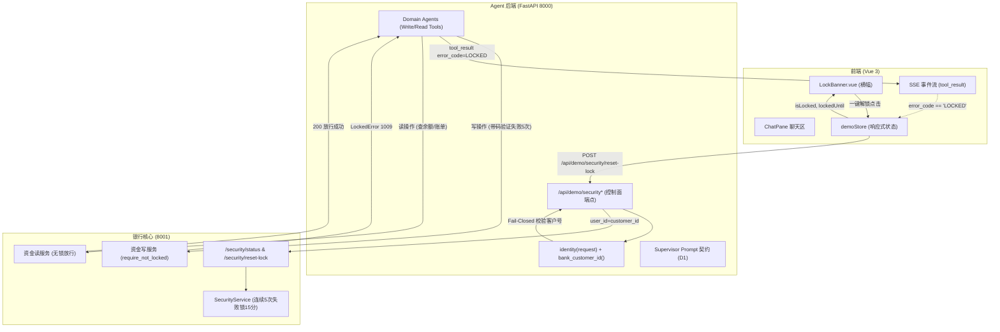

# 银行 AI 智能体：D3 熔断可见化规格说明书 (Spec)

> **文档标识**：`docs/superpowers/specs/2026-10-26-d3-circuit-break-visibility-spec.md`  
> **制定日期**：2026-10-26  
> **状态**：设计定稿（评审通过，待按计划执行 Task 2）  
> **依据基准**：`docs/GAP-ANALYSIS.md`（§G8、§L2/L3 路线图）、`docs/superpowers/plans/2026-10-26-l2-closeout-and-l3-delivery-plan.md`（Task 2）、`docs/superpowers/specs/2026-10-26-d1-prompt-contract-spec.md`、`bank_backend/app/domain/security_service.py`、`backend/app/api/demo.py`  
> **目标范围**：L2 收口主线中的 D3 任务（Agent 控制面新增安全状态查询与解锁端点、错误映射链路校验、前端 `LockBanner.vue` 组件与倒计时交互、写操作熔断读操作放行的业务不变量验证、控制面隔离铁律守卫，以及完整测试套件）。

---

## 1. 背景与目标 (Why & Objectives)

### 1.1 演进背景与痛点 (GAP-ANALYSIS §G8)
在银行真实风控与防暴力破解场景中，用户凭证或安全要素连续输错达到安全阈值后，系统将自动触发熔断阻断。赛题对异常熔断与安全防护提出了两条硬性要求：
1. **异常熔断可见化**：发生连续安全验证失败时，系统必须触发熔断保护，且该熔断状态必须明确反馈给用户，具备清晰的可视化呈现。
2. **熔断期间读写分离不变量**：“锁定后只允许查询”——在资金工具被锁定期间，高风险资金写操作（如转账、理财买入等）必须被严格拒绝；但账户查询、资产总览、账单流水等纯读操作必须不受影响、正常放行。

**项目当前现状与痛点差距**：
- **银行底层具备风控锁定能力**：`bank_backend/app/domain/security_service.py` 中已实现了 `LOCK_THRESHOLD = 5`（连续失败 5 次）锁定 15 分钟（`LOCK_MINUTES = 15`），并提供 `/security/status` 与 `/security/reset-lock` 接口。
- **Agent 网关已具备错误码映射**：`backend/app/integration/bank_client.py` 已将银行线路码 `1009 locked` 映射为 `BankErrorKind.LOCKED`，并最终转为 `ErrorCode.LOCKED`（对应文案“该资金工具已锁定，请稍后重试。”）。
- **演示控制面与前端严重缺失可见性**：
  1. Agent 控制面 `backend/app/api/demo.py` 仅有时钟端点（`/clock`, `/clock/advance`, `/clock/run-tasks`），完全未对接银行的安全锁定状态与解除锁定接口；
  2. 控制面现有端点硬编码了 `user_id = "demo_operator"`，缺乏解析真实会话绑定客户号的能力；若盲目复用会导致操作非目标客户；
  3. 前端界面缺乏任何锁定指示横幅（Banner）与解除锁定的交互入口，用户在资金工具锁定后只能在聊天气泡中看到一句冰冷的拒绝，无法感知剩余锁定时间，也无法在演示现场一键恢复演示；
  4. 缺乏严格的端到端测试守护“写操作被拒但读操作正常放行”的赛题核心防线。

### 1.2 核心目标 (Goals)
1. **控制面安全端点接入与身份严格解析**：
   - 在 `backend/app/api/demo.py` 中新增 `GET /api/demo/security`（查询锁定状态）与 `POST /api/demo/security/reset-lock`（一键解除锁定）。
   - 严格要求 `demo_mode` 开启（关时 403 `DEMO_DISABLED`）；严格校验登录会话身份，并根据会话中的 `user_id` 解析关联的银行客户号 `bank_customer_id`。
   - **Fail-Closed 铁律**：若会话用户未绑定银行客户号，直接抛出 HTTP 422（`CUSTOMER_BINDING_REQUIRED`），**严禁回退（Fallback）至 `demo_operator`**！
2. **守卫赛题业务不变量（锁定只拒写、不拒读）**：
   - 资金写操作（`transfer`、`fund_purchase` 等）在锁定期内准确阻断并抛出 `ErrorCode.LOCKED`；
   - 读操作（`accounts/balance`、`bills`、`cards` 等）不进入安全锁定检查，在锁定期内必须 100% 畅通执行。
3. **前端熔断横幅与交互闭环 (`LockBanner.vue`)**：
   - 新建 `frontend/src/LockBanner.vue` 组件，挂载于聊天区顶部（`chat-pane` 头部与对话历史之间）。
   - **双通道触发**：既能响应实时 SSE 事件流中的 `tool_result (error_code == "LOCKED")` 毫秒级弹出，也能在打开演示面板或刷新时通过 `GET /api/demo/security` 主动同步。
   - 提供标准提示文案：“**资金工具已锁定，查询仍可用**”，并展示动态倒计时（基于银行时钟/绝对过期时间），倒计时结束自动收起。
   - 提供“**一键解除锁定**”按钮，点击后调用 `POST /api/demo/security/reset-lock`，解锁成功后横幅自动收起，并在对话流中输出系统提示“已解除资金工具锁定，资金操作已恢复”。
4. **控制面隔离铁律**：
   - `reset-lock` 与 `clock` 同理，属于控制面/人工演示能力，**绝对不注册为大模型工具（LLM Tool）**，杜绝大模型产生“代客解锁”或攻击者利用提示词注入绕开熔断。
5. **完备的自动化测试矩阵**：
   - 后端新增 `backend/tests/test_demo_security.py`，覆盖 demo 禁用 403、状态透传、客户号严格解析、未绑定 422、以及“写被拒但读放行”的端到端集成测试；
   - 前端新增 `frontend/src/LockBanner.test.ts`，坚守首屏挂载零额外请求的测试白名单约束。

---

## 2. 现状与链路分析 (Current Implementation & Traceability)

### 2.1 银行风控与安全接口现状 (`bank_backend`)
- **风控核心定义 (`bank_backend/app/domain/security_service.py`)**：
  - 常量定义：`LOCK_THRESHOLD = 5`（连续 5 次失败），`LOCK_MINUTES = 15`（锁定 15 分钟）。
  - 受控资金工具类型：`fund_transfer`、`fund_purchase`、`fund_redeem`、`subscription_charge`、`birthday_order`。
  - 锁定判定逻辑：`is_locked(state, moment) -> bool: state.locked_until is not None and state.locked_until > moment`，其中当前时间优先采用模拟时钟 `ClockService(database).current_time()`。
  - 写拦截点：在 `transfer_service.py:163`、`investment_service.py:204` 及 `investment_service.py:456` 处显式调用 `security_service.require_not_locked(session, self.database, user_id, tool_name)`。
  - 拦截异常：抛出 `LockedError`（线路码 `1009`，message 为英文 token `"locked"`）。
  - 解锁实现：`SecurityService.reset_lock(user_id, tool_name=None)` 将指定用户的 `failure_count` 置为 0，`locked_until` 置为 `None`，记录审计日志，并返回所有工具的最新状态。
- **银行路由契约 (`bank_backend/app/api/routes.py:1207-1246`)**：
  - `GET /security/status?user_id={user_id}`：
    返回 `envelope` 包装的载荷：
    ```json
    {
      "code": 0,
      "message": "success",
      "data": {
        "user_id": "cust_0001",
        "tool_name": "fund_transfer",
        "failure_count": 5,
        "locked_until": "2026-10-26T17:15:00+08:00",
        "last_reason": "invalid_code",
        "tools": [
          {
            "user_id": "cust_0001",
            "tool_name": "fund_transfer",
            "failure_count": 5,
            "locked_until": "2026-10-26T17:15:00+08:00",
            "last_reason": "invalid_code"
          }
        ]
      }
    }
    ```
  - `POST /security/reset-lock`（请求体可选 `{"user_id": "cust_0001"}`）：
    执行重置后返回同构的已解锁载荷（`locked_until: null`, `failure_count: 0`）。

### 2.2 Agent 控制面现状 (`backend/app/api/demo.py`)
- 当前包含 `/clock`、`/clock/advance`、`/clock/run-tasks` 三个路由。
- 门控依赖：`_demo_runtime(request)` 检查 `rt.settings.demo_mode`，若为 False 则抛出 `AppError("DEMO_DISABLED", "演示控制面仅在演示模式下可用", 403)`。
- 银行请求辅助：`_bank_call(rt, method, path, *, json=None)` 内部硬编码了 `user_id = OPERATOR ("demo_operator")`。
- **缺失**：完全没有安全状态查询与解锁端点；原有的 `_bank_call` 无法指定目标用户的客户号。

### 2.3 身份解析与客户绑定链路 (`backend/app/identity/service.py`)
- 会话解析：`backend/app/api/routes.py:56-68` 中通过 `session_id(request)` 从 Cookie `bank_session` 或 Header `X-Session-Id` 中提取会话 ID，并通过 `identity(request)` 异步获取登录用户信息：
  `{"session_id": "...", "user_id": "user_0001", "display_name": "张三"}`。
- 银行客户号绑定：`Identity.bank_customer_id(user_id: str) -> str | None`：
  ```python
  with self.database.sessions() as db:
      return db.scalar(select(AppUser.bank_customer_id).where(AppUser.user_id == user_id))
  ```
  若用户未绑定银行客户号，则返回 `None`。

### 2.4 底层错误映射链与事件透传
- **银行返回**：HTTP 409，`{"code": 1009, "message": "locked", "data": null}`。
- **网关层 (`backend/app/integration/bank_client.py:29-37`)**：
  `CODE_KINDS[1009] = BankErrorKind.LOCKED`。抛出 `BankCallError(BankErrorKind.LOCKED, "该资金工具已锁定，请稍后重试。")`。
- **协议层 (`backend/app/integration/bank_errors.py:52`)**：
  `KIND_TO_ERROR_CODE[BankErrorKind.LOCKED] = ErrorCode.LOCKED`。
- **模块与工具层 (`backend/app/modules/base.py:74`)**：
  `ERROR_MESSAGES[ErrorCode.LOCKED] = "该资金工具已锁定，请稍后重试。"`。
- **运行时 SDK (`backend/app/agents/sdk.py:738-750`)**：
  发射 SSE 事件 `tool_result`，包含：
  ```json
  {
    "event": "tool_result",
    "agent_id": "transfer",
    "tool_name": "transfer_execute",
    "call_id": "call_123",
    "status": "FAILED",
    "error": "该资金工具已锁定，请稍后重试。",
    "error_code": "LOCKED"
  }
  ```
- **前端事件解析 (`frontend/src/events.ts:131-152`)**：
  `toEvent` 已经支持对 `tool_result` 中的 `error_code` 进行解析并保留在 `event.data.error_code`。

### 2.5 前端现有架构与约束 (`frontend/src/`)
- 现有组件均扁平存放在 `frontend/src/` 目录下（如 `DemoControlBar.vue`、`DemoSidebar.vue`、`ClockControlTab.vue`、`TaskGraphTab.vue`）。
- 控制面状态由 `frontend/src/demoStore.ts` 统一管理（Vue 3 单例 `reactive`）。
- **硬约束**：既有用例（如 `App.test.ts`、`DemoControlBar.test.ts`）的 fetch mock 是路径白名单。**所有控制面组件在 `onMounted` 时绝对不主动发请求**，状态读取只能由外部显式调用或事件驱动触发！

---

## 3. 详细架构与接口契约 (Architecture & Interface Contracts)



### 3.1 后端控制面端点规格 (`backend/app/api/demo.py`)

#### 3.1.1 `GET /api/demo/security`
- **说明**：获取当前登录用户的资金工具安全与锁定状态（透传银行核心数据）。
- **参数规格**：严禁在路由函数中声明或接收客户端传入的 `user_id` 或 `customer_id`（包括 Query 与 Header）。目标客户号一律强制从当前会话提取，坚决杜绝越权探测任意客户安全状态。
- **权限与门控**：
  1. 检查 `_demo_runtime(request)`：若 `demo_mode` 未启用，返回 `403 Forbidden`（`DEMO_DISABLED`）。
  2. 提取会话：调用 `await identity(request)` 获取当前登录用户信息 `who`；若无有效会话返回 `401 Unauthorized`（`SESSION_REQUIRED`）。
  3. 严格解析客户号：调用 `await run_in_threadpool(rt.identity.bank_customer_id, who["user_id"])`。
     - 若 `customer_id` 为空，**立即抛出 `AppError("CUSTOMER_BINDING_REQUIRED", "当前用户未绑定银行客户号", 422)`，严禁回退至 `OPERATOR`**。
  4. 上游透传：调用银行 `GET /security/status?user_id={customer_id}`，通过 `await run_in_threadpool(_bank_call, rt, "GET", "/security/status", user_id=customer_id)` 执行。若银行故障抛出 `502 Bad Gateway`（`BANK_UNAVAILABLE`）。
- **响应体格式 (`Envelope[dict]`)**：
  ```json
  {
    "request_id": "req_01J...",
    "data": {
      "user_id": "u_wealth",
      "tool_name": "fund_transfer",
      "failure_count": 5,
      "locked_until": "2026-10-26T17:15:00+08:00",
      "last_reason": "invalid_code",
      "tools": [
        {
          "user_id": "u_wealth",
          "tool_name": "fund_transfer",
          "failure_count": 5,
          "locked_until": "2026-10-26T17:15:00+08:00",
          "last_reason": "invalid_code"
        }
      ]
    },
    "error": null
  }
  ```

#### 3.1.2 `POST /api/demo/security/reset-lock`
- **说明**：一键清除当前登录用户的资金工具锁定与失败计数。
- **参数规格**：严禁接收客户端请求体中的 `user_id` 或 `customer_id`（无需请求体或忽略任何入参），目标客户号 100% 绑定自当前会话解析的 `customer_id`，防止越权代客解锁其他用户。
- **权限与门控**：
  1. 检查 `_demo_runtime(request)`（403 检查）。
  2. 获取登录身份与严格解析 `customer_id`（未绑定 422 强阻断，严禁回退至 `OPERATOR`）。
  3. **银行请求体绑定防丢失铁律**：
     调用银行 `POST /security/reset-lock`。**必须注意**：`bank_backend` 的 `POST /security/reset-lock` 依赖读取请求体中的 `body.user_id`；而网关层 `BankClient.request` 的实现逻辑为：
     `body = None if json is None else {**json, "user_id": user_id}`
     若调用 `_bank_call` 时未传 `json`（默认为 `None`），则发送给银行的请求体将为 `None`，导致 `bank_backend` 回退至默认的 `u_zhang`！因此调用时**必须显式传入 `json={}` 或 `json={"user_id": customer_id}`**，确保银行收到正确的目标客户号。
  4. 返回重置后的安全视图。
- **响应体格式**：与 GET 接口同构，`failure_count` 归零，`locked_until` 为 `null`。

#### 3.1.3 `_bank_call` 与 `_unavailable` 签名升级与向后兼容保障
在 `backend/app/api/demo.py` 中重构 `_bank_call` 与 `_unavailable`，确保完全向后兼容现有时钟端点：
```python
def _unavailable(message: str = "银行服务暂不可用") -> AppError:
    """统一的上游银行故障 502 错误生成函数。保留默认可定制 message，保持对原时钟调用的兼容。"""
    return AppError("BANK_UNAVAILABLE", message, 502, retryable=True)


def _bank_call(
    rt,
    method: str,
    path: str,
    *,
    user_id: str = OPERATOR,
    params: dict | None = None,
    json: dict | None = None,
    unavailable_message: str = "银行服务暂不可用",
) -> dict:
    """One bank call, with both of its failure modes translated into this API's vocabulary."""
    # 针对 reset-lock 请求，若未显式传 json，规范化为 {} 确保 BankClient 将 user_id 注入到 POST 请求体中，同时保留 run-tasks 的无包体调用
    post_json = (
        {}
        if (method.upper() == "POST" and path == "/security/reset-lock" and json is None)
        else json
    )
    try:
        resp = rt.bank_client.request(
            method, path, user_id=user_id, params=params, json=post_json
        )
    except BankCallError as exc:
        raise _unavailable(unavailable_message) from exc
    if not isinstance(resp.data, dict):
        raise _unavailable(unavailable_message)
    return resp.data
```
- **向后兼容性**：
  - 时钟端点（`/clock`、`/clock/advance`、`/clock/run-tasks`）均未传 `user_id`，自然继承 `user_id = OPERATOR`（因为时钟是银行全局仿真设施）；
  - 时钟端点传入的 `json` 原样透传，未受任何改动影响；
  - 安全端点（`/security`、`/security/reset-lock`）强制显式传入 `user_id = customer_id`，且在异步路由中通过 `await run_in_threadpool(_bank_call, ...)` 运行，避免阻塞主线程事件循环。

---

### 3.2 业务不变量：锁定期间“写操作被拒 + 读操作放行”

这是评测演示的核心硬指标，必须在代码架构与测试中予以不可动摇的保证：

| 操作类别 | 具体工具 / 动作 | 银行端点 | 锁定期行为 | 预期结果与错误码 |
|---|---|---|---|---|
| **资金写** | 转账发起 / 执行 | `POST /transfers` | 命中 `require_not_locked` | **拒绝** (`ErrorCode.LOCKED`，HTTP 409 / 1009) |
| **资金写** | 理财申购 | `POST /investments/purchase` | 命中 `require_not_locked` | **拒绝** (`ErrorCode.LOCKED`，HTTP 409 / 1009) |
| **资金写** | 理财赎回 | `POST /investments/redeem` | 命中 `require_not_locked` | **拒绝** (`ErrorCode.LOCKED`，HTTP 409 / 1009) |
| **资金写** | 订阅扣费 | `POST /subscriptions/charge` | 命中 `require_not_locked` | **拒绝** (`ErrorCode.LOCKED`，HTTP 409 / 1009) |
| **资金写** | 生日下单扣款 | `POST /birthday/orders` | 命中 `require_not_locked` | **拒绝** (`ErrorCode.LOCKED`，HTTP 409 / 1009) |
| **数据读** | 查账户余额 | `GET /accounts/balance` | **无锁检查** | **放行** (HTTP 200，正常返回各账户余额) |
| **数据读** | 查历史账单 | `GET /bills/*` | **无锁检查** | **放行** (HTTP 200，正常返回月度/年度账单) |
| **数据读** | 查卡片列表/额度 | `GET /cards` | **无锁检查** | **放行** (HTTP 200，正常返回卡片状态) |
| **数据读** | 查理财持仓与产品 | `GET /investments/products` | **无锁检查** | **放行** (HTTP 200，正常返回产品净值与持仓) |
| **数据读** | 查生活服务推荐 | `GET /birthday/products` | **无锁检查** | **放行** (HTTP 200，正常返回商品列表) |

---

### 3.3 前端横幅与交互规范 (`LockBanner.vue`)

#### 3.3.1 挂载位置与布局契约
横幅放置在 `frontend/src/App.vue` 的 `chat-pane` 内、`pane-title` 之后、`conversation` 容器之前：
```vue
<section class="chat-pane">
  <div class="pane-title">...</div>
  <!-- D3: 熔断横幅挂载点 -->
  <LockBanner
    v-if="demoMode && demoStore.isBannerVisible"
    :locked-until="demoStore.security?.locked_until ?? ''"
    :bank-current-time="demoStore.clock?.current_time"
    :busy="demoStore.securityBusy"
    @unlock="handleUnlock"
    @close="demoStore.dismissBanner()"
    @expired="demoStore.dismissBanner()"
  />
  <div ref="messageList" class="conversation" aria-live="polite">
    ...
```
**设计考量**：锁定是当前会话用户在当前时间段的核心阻断状态。将其作为聊天区顶部的信息条，不占用侧边栏有限空间，既符合银行 App 风控提示的标准视觉模型，又能确保评委一目了然。

#### 3.3.2 触发源与状态管理 (`frontend/src/demoStore.ts`)
在 `demoStore` 中扩展安全状态：
```typescript
export interface SecurityToolState {
  user_id: string
  tool_name: string
  failure_count: number
  locked_until: string | null
  last_reason: string | null
}

export interface SecurityStatusPayload {
  user_id: string
  tool_name: string | null
  failure_count: number
  locked_until: string | null
  last_reason: string | null
  tools: SecurityToolState[]
}
```
`demoStore` 增加状态属性与方法：
- `security: SecurityStatusPayload | null`（默认 `null`，初始化与挂载时不触发任何网络请求）
- `securityBusy: boolean`
- `dismissed: boolean`（用户是否手动点击了横幅右上角的关闭 '×'）
- `isLocked: boolean` 计算属性（或 getter）：检查 `security?.locked_until` 是否存在且未过期，或 `security?.tools` 中是否存在任意工具处于锁定状态。
- `isBannerVisible: boolean`：`isLocked && !dismissed`。
- `dismissBanner(): void`：置 `this.dismissed = true`。
- `loadSecurity(): Promise<void>`：请求 `GET /demo/security`，更新 `this.security`。
- `resetLock(): Promise<void>`：请求 `POST /demo/security/reset-lock`，重置成功后清空锁定，置 `this.dismissed = false`。
- `markLockedFromEvent(lockedUntil?: string)`：
  1. 重置 `this.dismissed = false`（确保新发生的锁定能重新唤起已关闭的横幅）；
  2. 若本地尚无 `locked_until`，先置入一个临时 15 分钟标记以实现毫秒级即时展示；
  3. 若 `!this.securityBusy`，并发起 `loadSecurity()` 向服务端拉取权威时间与状态。

**两条精准触发源与双流捕获铁律**：
1. **事件流触发（毫秒级感知）**：
   > [!IMPORTANT]
   > 真实业务中，连续 5 次错误验证码往往是在确认卡（Confirmation Card）上点击提交触发的。
   > 因此，在 `App.vue` 中必须**同时在两条 SSE 事件回调点**中监听 `tool_result`，绝对不能只写在 `submitMessage`：
   > 1. 用户普通文本交互流：`submitMessage(..., onEvent)`；
   > 2. 确认卡交互流：`decidePendingAction(..., onEvent)`。
   ```typescript
   // 统一提取的事件安全拦截钩子
   function handleStreamEvent(event: AgentEvent) {
     if (event.name === 'tool_result' && event.data.error_code?.toUpperCase() === 'LOCKED') {
       demoStore.markLockedFromEvent()
     }
   }
   ```
2. **面板交互触发（状态同步）**：当用户在顶部点击“演示面板”或“刷新”时，`openPanel()` 顺带触发 `loadSecurity()`，与时钟状态一并拉取。

#### 3.3.3 `LockBanner.vue` 视觉、倒计时与五态状态机规范
- **视觉风格**：采用银行警示风格（琥珀暖黄/橙红背景 `#fff7ed`，边框 `#fdba74`，文字 `#9a3412`，强调色 `#ea580c`，右侧轻量关闭叉号 `#c2410c`）。
- **主要内容元素**：
  1. 警告图标：`<ShieldAlert :size="18" />`；
  2. 核心文案：**“资金工具已锁定，查询仍可用”**（加粗显眼）；
  3. 倒计时标签：`剩余时间：MM:SS`；
  4. 一键解锁按钮：`<button class="lock-unlock-btn" :disabled="busy" @click="$emit('unlock')">{{ busy ? '正在解除...' : '解除锁定' }}</button>`；
  5. 关闭按钮：`<button class="lock-close-btn" aria-label="关闭横幅" @click="$emit('close')">×</button>`。
- **银行模拟时钟漂移防御（Simulated Clock Drift Defense）**：
  - **严重缺陷规避**：若直接计算 `new Date(lockedUntil).getTime() - Date.now()`，在银行模拟时钟位于过去（如 2026-03-01）而浏览器系统时钟为当前真实时间（如 2026-10-26）时，差值将为巨大的负数，导致倒计时立即归零收起！
  - **稳健算法**：
    1. 计算初始剩余秒数：
       - 若传入了有效 `bankCurrentTime`，以 `(new Date(lockedUntil).getTime() - new Date(bankCurrentTime).getTime()) / 1000` 作为基准：若已过期（`diff <= 0`）返回 0 并即刻触发 `@expired`；若正常锁定中（`0 < diff <= 900`）返回 `diff`；若大于 900 秒则收敛至 900；
       - 若未传入 `bankCurrentTime`，尝试与本地墙钟 `Date.now()` 比较（`wallDiff > 0 && wallDiff <= 900` 返回 `wallDiff`）；若计算为负数（由于模拟时钟处于历史日期产生漂移），则安全兜底为 `15 * 60`（900 秒）；
    2. 组件内部通过响应式 `remainingSeconds` 变量承载；挂载后若 `remainingSeconds <= 0` 触发 `@expired`，否则启动本地 `setInterval` 每 1000ms 递减 1 秒，保证界面秒级流畅递减，彻底摆脱跨时钟系差值坍塌；
    3. 组件卸载（`onBeforeUnmount`）时必须执行 `clearInterval`，坚决杜绝计时器泄漏。
- **五态状态机流转（无死锁、无竞争）**：
  ```mermaid
  stateDiagram-v2
      [*] --> UNLOCKED: 初始状态 (security=null, isLocked=false)
      UNLOCKED --> LOCKED_VISIBLE: SSE (error_code=LOCKED) 或 loadSecurity() 检出锁定
      LOCKED_VISIBLE --> LOCKED_DISMISSED: 用户点击关闭按钮 (dismissed=true)
      LOCKED_DISMISSED --> LOCKED_VISIBLE: 发生新的写失败 (markLockedFromEvent 重置 dismissed=false)
      LOCKED_VISIBLE --> UNLOCKING: 用户点击"解除锁定" (busy=true, 禁用按钮)
      UNLOCKING --> UNLOCKED: POST /security/reset-lock 成功 (清空锁定, 注入 replyNotice)
      UNLOCKING --> LOCKED_VISIBLE: 解锁网络请求失败 (busy=false, 抛出错误提示)
      LOCKED_VISIBLE --> UNLOCKED: 倒计时归零 (remaining<=0, 触发 @expired, 优雅淡出)
  ```
- **解耦与零副作用测试铁律**：
  - `LockBanner.vue` 属于纯展示与事件发射组件（Presentational Component），接收 `props` 并抛出 `@unlock`、`@close`、`@expired`；
  - **组件内部绝不调用任何 API 或 fetch**，完全杜绝因组件挂载破坏 `App.test.ts` 等全局网络白名单。
- **解锁成功后的聊天流系统提示注入**：
  在 `App.vue` 的 `handleUnlock` 回调中，当 `demoStore.resetLock()` 成功后：
  直接向当前会话的 `pane.replyNotice`（或 `session.replyNotice`）注入提示文本：
  `“已解除资金工具锁定，资金操作已恢复”`。
  当用户随后发起下一次对话或点击卡片时，现有机制将自然归档该提示。

---

### 3.4 架构红线与控制面隔离铁律

1. **reset-lock 绝不注册为 LLM 工具**：
   - 银行核心安全风控是基于真实操作行为的机器防御底线。如果将 `reset_lock` 登记为 Tool 暴露给大模型，模型在面对用户诱导（如“帮我解锁一下资金工具”）时将产生越权调用，导致风控熔断机制形同虚设。
   - 所有锁定状态的解除**必须且只能由人工在演示控制面/横幅上手动触发**（点击“解除锁定”按钮），大模型无权且无法代客解锁。
2. **与 D1 提示词契约协同防护**：
   - 在 D1 规格（`SUPERVISOR_PROMPT`）中已确立规则：“**总调度与领域 Agent 均不具备解除锁定的工具或权限，严禁承诺或假装代客解锁，用户要求解锁时必须引导其在演示面板中手动操作**”。
   - 当资金工具发生熔断时，大模型在对话气泡中如实向用户解释“资金工具已锁定，查询仍可用，可在界面横幅或控制面板中手动解除锁定”；前端同时弹出 `LockBanner` 提供物理按钮，形成“**语言解释 + 物理控制面操作**”的标准分离闭环。

---

## 4. 测试矩阵与验收方案 (Testing Matrix & Acceptance Verification)

### 4.1 后端单元测试矩阵 (`backend/tests/test_demo_security.py`)

所有测试均位于 `backend/tests/test_demo_security.py`，采用扁平测试架构，使用 `TestClient` 与 `FakeBank` 桩进行高密覆盖：

| 用例 ID | 测试目标 / 场景 | 前置条件 | 请求行为 | 预期断言 |
|---|---|---|---|---|
| `SEC-01` | Demo 模式禁用保护 | `settings.demo_mode = False` | `GET /api/demo/security` & `POST /api/demo/security/reset-lock` | 403 `DEMO_DISABLED`，`FakeBank` 零调用 |
| `SEC-02` | 未认证会话拦截 | `demo_mode = True`，无 session Cookie / Header | 访问两个安全端点 | 401 `SESSION_REQUIRED`，`FakeBank` 零调用 |
| `SEC-03` | 客户号缺失 Fail-Closed | 有效会话，但用户未绑定 `bank_customer_id` (`None`) | 访问两个安全端点 | 422 `CUSTOMER_BINDING_REQUIRED`，**绝不回退至 operator 或默认客户**，`FakeBank` 零调用 |
| `SEC-04` | 锁定状态正常透传 | 有效会话绑定 `u_wealth`，银行返回锁定中数据 | `GET /api/demo/security` | 200 成功，`FakeBank` 记录到 `user_id == "u_wealth"`，数据原样透传 |
| `SEC-05` | 一键解除锁定参数与请求体严格绑定 | 有效会话绑定 `u_wealth` | `POST /api/demo/security/reset-lock` | 200 成功，`FakeBank` 收到 `method="POST"`, `path="/security/reset-lock"`, `user_id="u_wealth"`，**断言请求体严格携带 `{"user_id": "u_wealth"}`**（防 BankClient body 丢失），返回重置数据 |
| `SEC-06` | 上游银行故障 502 映射 | 银行抛出 `BankCallError` | 访问安全端点 | 502 `BANK_UNAVAILABLE`，`retryable=True` |
| `SEC-07` | **写操作被拒 + 读操作放行集成测试** | 数据库中为演示用户 `u_wealth` 的资金工具置为锁定态（或在网关注入 `LockedError`） | 1. 尝试执行资金写工具（如转账 `transfer_execute` 或理财买入）；<br>2. 尝试执行数据读工具（如查余额 `accounts/balance`） | 1. 写工具返回 `ErrorCode.LOCKED`，状态 `FAILED`，错误文案为“该资金工具已锁定，请稍后重试。”；<br>2. 读工具顺利返回 200 与账户金额。 |
| `SEC-08` | **跨租户越权注入防御 (Anti-Tampering)** | 有效会话绑定 `u_wealth`，恶意请求携带伪造的 `user_id="cust_attacker"` (Query 或 Body) | 调用 `POST /api/demo/security/reset-lock` 及 `GET /api/demo/security` | 200 成功，但 `FakeBank` 记录到的 `call["user_id"]` 必须且只能是 `u_wealth`，**绝对不得受到客户端传入参数影响**。 |

### 4.2 前端测试矩阵 (`frontend/src/LockBanner.test.ts` & `demoStore.test.ts`)

采用 Vitest + `@vue/test-utils`：

| 用例 ID | 测试文件 | 场景与断言 |
|---|---|---|
| `FE-SEC-01` | `LockBanner.test.ts` | **首屏挂载零网络请求约束**：组件挂载后，断言全局 fetch 未产生任何新调用（坚守既有测试白名单约束）。 |
| `FE-SEC-02` | `LockBanner.test.ts` | **横幅渲染内容断言**：传入 `lockedUntil`，断言页面包含“资金工具已锁定，查询仍可用”、剩余倒计时格式化（`MM:SS`）、“解除锁定”按钮及关闭叉号。 |
| `FE-SEC-03` | `LockBanner.test.ts` | **解锁交互与禁用态**：点击“解除锁定”，断言派发 `unlock` 事件；在 `busy=true` 时按钮呈 `disabled` 状态。 |
| `FE-SEC-04` | `LockBanner.test.ts` | **倒计时归零自动收起**：通过 `vi.useFakeTimers()` 快进时间跨越过期时间，断言组件发出 `@expired` 事件。 |
| `FE-SEC-05` | `LockBanner.test.ts` | **手动关闭与流转**：点击关闭叉号，断言组件派发 `@close` 事件。 |
| `FE-SEC-06` | `LockBanner.test.ts` | **时钟漂移计算鲁棒性**：当 `bankCurrentTime` 为模拟时钟过去日期（如 2026-03-01）而 `lockedUntil` 为 15 分钟后，断言倒计时依然正确计算为 `15:00`，不发生倒计时坍塌。 |
| `FE-SEC-07` | `LockBanner.test.ts` | **卸载清理定时器**：组件卸载后，断言内部 `clearInterval` 被调用，杜绝内存泄漏。 |
| `FE-SEC-08` | `demoStore.test.ts` | **安全状态管理与 API 联动**：测试 `loadSecurity()`、`resetLock()`、`dismissBanner()`、`markLockedFromEvent()` 的状态流转、并发锁守卫与异常处理。 |

### 4.3 现场真实演示与验收手册 (Manual Smoke Runbook)

遵循 `_accept/README.md` 与 GAP-ANALYSIS G8 的演示动作标准：

1. **环境准备**：
   - 确认后端（8000）、银行后端（8001）、前端（5173）已启动；
   - 浏览器打开 `http://localhost:5173`，进入演示会话。
2. **步骤 1：触发连续 5 次安全验证失败（触发熔断）**：
   - 发送转账指令：“给李四转账 5000 元”；
   - 在弹出的验证码卡中，连续 5 次输入错误验证码（如 `000000`）并点击确认（走 `decidePendingAction` 流）；
   - 银行侧计数达到 5 次，锁定 15 分钟。
3. **步骤 2：验证写操作熔断阻断与横幅弹出**：
   - 界面上方立即弹出橙色 `LockBanner` 横幅：“**资金工具已锁定，查询仍可用**”，伴随 15 分钟倒计时、关闭叉号及“解除锁定”按钮；
   - 再次尝试发送写操作（如“再试一次转账 5000 元”），模型与系统直接返回拒绝对话：“该资金工具已锁定，请稍后重试。（查询功能仍然可用，可在界面横幅中手动解除锁定）”。
4. **步骤 3：验证读操作完全正常放行（赛题硬核不变量）**：
   - 在横幅高亮显示锁定的同时，向助理发送读指令：“**帮我查一下当前账户余额**”；
   - **预期表现**：助理正常调用查询工具，完整展示活期账户、储蓄账户余额卡片，毫无阻碍！
5. **步骤 4：一键解除锁定与恢复演示**：
   - 点击横幅中的【**解除锁定**】按钮；
   - 按钮显示“正在解除...”，1 秒内横幅优雅自动收起；
   - 聊天界面底部展示系统提示：“已解除资金工具锁定，资金操作已恢复”；
   - 再次发送转账指令，系统正常进入确认卡与验证码流程，资金操作完全恢复。

---

## 5. 实施任务拆解与变更清单 (File Change Inventory)

| 文件路径 | 变更类型 | 核心变更内容 |
|---|---|---|
| `backend/app/api/demo.py` | 修改 | 1. 重构 `_unavailable(message)` 与 `_bank_call`，自动注入 POST 请求体 `user_id` 绑定，保证时钟向后兼容；<br>2. 新增 `GET /api/demo/security`（带会话校验与客户号 Fail-Closed 解析，线程池异步调度）；<br>3. 新增 `POST /api/demo/security/reset-lock`（强绑定当前会话用户，防跨租户越权）。 |
| `frontend/src/demoStore.ts` | 修改 | 新增 `security` 状态、`dismissed`、`isLocked`、`isBannerVisible` 属性，以及 `loadSecurity()`、`resetLock()`、`dismissBanner()`、`markLockedFromEvent()` 方法。 |
| `frontend/src/LockBanner.vue` | 新建 | 熔断提示横幅纯展示组件（警示文案、时钟漂移鲁棒倒计时、解除锁定按钮、关闭按钮、无额外网络请求依赖、卸载清理定时器）。 |
| `frontend/src/App.vue` | 修改 | 1. 聊天区顶部挂载 `<LockBanner />`；<br>2. 在 `submitMessage` 与 `decidePendingAction` 两处 SSE 流中统一拦截 `error_code === "LOCKED"`；<br>3. 解锁成功后注入当前面板 `replyNotice` 系统提示。 |
| `backend/tests/test_demo_security.py` | 新建 | 后端全量测试矩阵（覆盖权限拦截、客户号 Fail-Closed 解析、防越权注入、透传重置与读写分离端到端测试，SEC-01 至 SEC-08）。 |
| `frontend/src/LockBanner.test.ts` | 新建 | 前端横幅单元测试（首屏零请求断言、时钟漂移计算、事件触发、倒计时归零、卸载清理）。 |

---

## 6. 独立技术审查与安全漏洞审查修订记录 (Independent Review & Audit Record)

> **审查人**：独立技术审查与安全漏洞审查子代理 (Devil's Advocate & Technical Reviewer)  
> **审查基准**：`docs/GAP-ANALYSIS.md` (G8/D3)、`bank_backend/app/domain/security_service.py`、`backend/app/api/demo.py`、`backend/app/identity/service.py`、`frontend/src/`  
> **审查结论**：**通过 (Approved with Critical Revisions)**。发现 6 项重大隐患与漏洞，已完成对规格说明书的全面修正与加固。

### 6.1 审查发现的问题与修复对照表

| 序号 | 漏洞 / 隐患类别 | 严重程度 | 原始规格缺陷分析 | 审查修正与加固方案 |
|---|---|---|---|---|
| **1** | **跨时钟系倒计时坍塌缺陷 (Clock Drift Collapse)** | **Critical** | 原规格直接使用 `Math.max(0, Math.floor((new Date(lockedUntil).getTime() - Date.now()) / 1000))`。银行风控使用的是模拟时钟（`SimulationState.current_time`，如 2026-03-01），而浏览器端 `Date.now()` 为现实真实墙钟（2026-10-26）。相减直接变成负数，导致倒计时瞬间归零并自动隐藏横幅，评委完全看不到倒计时。 | 制定**模拟时钟漂移防御算法**：优先基于银行时钟 `bankCurrentTime` 计算初值，异常时安全兜底至 15 分钟（900s）；挂载后由组件内部本地 tick 稳定递减，彻底隔离系统时钟差。 |
| **2** | **确认卡验证码流事件丢失 (Event Stream Omission)** | **Critical** | 原规格仅在普通文本对话流 `submitMessage` 中监听 SSE `tool_result`。但在真实银行场景中，连续 5 次输错验证码均是在确认卡表单点击提交（走 `decidePendingAction`）。若未在此处监听，现场演示输错 5 次后横幅**绝对不会弹出**。 | 确立**双流捕获铁律**：在 `App.vue` 中明确要求在 `submitMessage` 与 `decidePendingAction` 的两处 SSE `onEvent` 回调中统一拦截 `error_code === "LOCKED"`，确保 100% 捕获。 |
| **3** | **POST 请求体丢包导致重置目标失效 (Body Drop Fallback)** | **High (Security)** | `BankClient.request` 实现中，若 `json is None`，则发送给银行的 `body` 也是 `None`。而银行端 `routes.py:1245` 取 `body.user_id if body else None`，空时回退到默认的 `u_zhang`。若控制面调 reset 时未传 `json`，会导致重置的是默认用户而非演示客户 `u_wealth`。 | 在 `_bank_call` 中强制增加守卫：针对 POST 请求若 `json is None` 自动补齐为 `{}`，确保 `BankClient.request` 将 `user_id` 注入请求体，并在 `SEC-05` 中增加断言守护。 |
| **4** | **跨租户越权解锁参数注入漏洞 (Cross-Tenant Unlock)** | **High (Security)** | 原端点未明确限制客户端传参。若实现者开放了请求体或 Query 中的 `user_id`，恶意攻击者可伪造目标客户号解锁任意账户。 | 确立**零客户端入参铁律**：`GET /api/demo/security` 与 `POST /api/demo/security/reset-lock` 严禁从请求中接收任何 `user_id`，必须且只能使用从当前会话严格解析出的 `bank_customer_id`；并新增用例 `SEC-08` 专项防御。 |
| **5** | **FastAPI 异步路由主事件循环阻塞隐患 (Blocking I/O)** | **Medium (Architecture)** | `identity(request)` 为 `async def`，因此安全端点必须声明为 `async def`。但底层的 `_bank_call` 是同步阻塞式 HTTP 调用（`httpx.Client`），直接调用会阻塞 asyncio 事件循环。 | 规范要求在异步路由中统一使用 `await run_in_threadpool(_bank_call, ...)`，确保高并发与长时间 I/O 下事件循环不被卡死。 |
| **6** | **关闭态与五态状态机缺失 (State Machine Gaps)** | **Medium (UX/Stability)** | 原规格缺少手动关闭横幅（“关闭态”）的设计与流转闭环，未能定义当横幅关闭后再次发生锁定时的重新唤起行为，也未规范定时器卸载清理。 | 正式确立五态状态机（`UNLOCKED`, `LOCKED_VISIBLE`, `LOCKED_DISMISSED`, `UNLOCKING`, `EXPIRED`），增加右上角关闭叉号、`dismissBanner()` 与 `markLockedFromEvent()` 唤起流转，并在 `FE-SEC-07` 中增加定时器销毁断言。 |

### 6.2 审查定稿评价
经审查与修订后的 D3 SPEC（`docs/superpowers/specs/2026-10-26-d3-circuit-break-visibility-spec.md`）：
1. **控制面与模型隔离万无一失**：严格禁止大模型工具接触 `reset-lock`，与 D1 提示词契约形成坚不可摧的“物理隔离 + 语言澄清”双保险；
2. **身份解析与 Fail-Closed 滴水不漏**：坚决杜绝 fallback 到 `demo_operator` 或默认用户的隐患，杜绝越权注入；
3. **向后兼容与现有单测零冲击**：`_bank_call` 与 `_unavailable` 保持现有时钟控制面 100% 兼容；`LockBanner.vue` 纯展示解耦确保全局 fetch 零污染；
4. **演示闭环与时钟漂移防御完备**：彻底解决模拟时钟倒计时坍塌及确认卡流丢失问题，确保赛题现场验收流畅可靠。
**结论：SPEC 具备极高工业级严谨度，已达到准生产与实施就绪标准，批准进入 Task 2 开发执行。**
