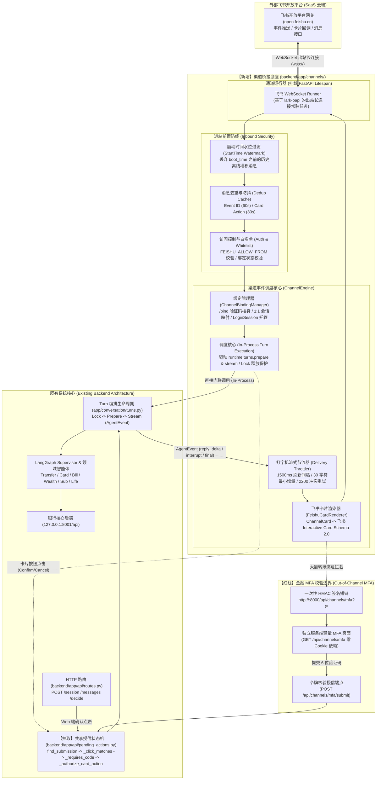
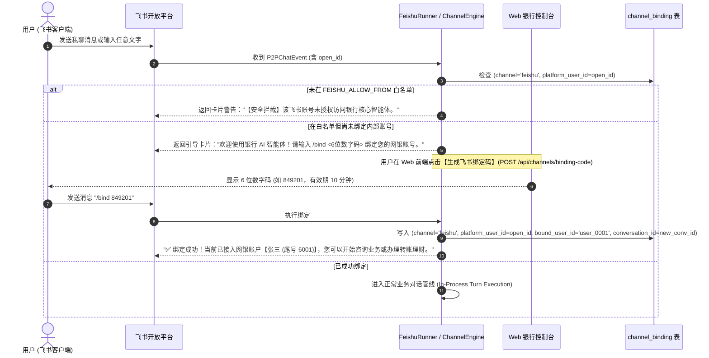

# 银行 AI 智能体：飞书 IM 渠道接入 (Feishu WebSocket Bridge) 架构设计规格说明书 (Spec)

> **文档标识**：`docs/superpowers/specs/2026-10-27-im-channel-bridge-design.md`  
> **制定日期**：2026-10-27  
> **状态**：定稿发布 (Reviewed & Solidified - 飞书单渠道深度闭环版)  
> **依据基准**：
> - 赛题要求：`docs/requirements/银行 AI 智能体赛题.md`（§二：用户可通过 APP、IM 等渠道与 Agent 联通）
> - PRD 基线：`docs/requirements/AI Banking Agent 系统需求文档 (PRD).md`（§一.2 渠道适配层解耦原则）
> - 缺口分析：`docs/GAP-ANALYSIS.md`（§2 G12 渠道接入缺口填补）
> - 代码库红线：`backend/app/api/routes.py:489-582`（授信与确认不可混淆，金融操作必须具备单一真实源授信校验链）
> - 用户决议与范围收敛：
>   1. **纯粹专注飞书**：按用户最新要求（m00247 "算了，不做tgbot，只做飞书"），剔除 Telegram 相关所有组件与代理依赖，集中攻坚飞书原生体验；
>   2. **个人号自建应用**：利用飞书开放平台企业自建应用免认证机制，使用长连接模式，零企业资质门槛；
>   3. **MFA 签名短链闭环**：严守银行安全红线，短信验证码走独立服务端渲染与令牌校验端点，禁止在飞书端明文输入；
>   4. **共享授信状态机**：抽取 `backend/app/api/pending_actions.py` 共享服务，HTTP 路由与飞书卡片回调共用同一套金融级授信逻辑；
>   5. **安全默认拒绝**：`ALLOW_FROM` 白名单机制保障系统内网安全。
> - **自审修订项 (Self-Review Fixes)**：
>   1. 彻底解决移动端 Feishu 打开 MFA 链接缺少浏览器 `bank_session` Cookie 的 401 跨端鉴权问题（改由独立服务端点校验 HMAC Token）；
>   2. 补齐 `Settings` 中的 `secret_key` 与 `channel_mfa_base_url`，消除运行期属性缺失隐患；
>   3. 补齐 Alembic 数据库迁移规范（`0018_channel_binding.py`，衔接 `0017`）；
>   4. 明确渠道层 `who` 身份会话的自动换发与 `HeldLock` 强制释放机制；
>   5. 制定飞书 Card Action 3 秒超时同步响应与后续异步 PATCH 更新机制。

---

## 1. 概述与设计定位 (Executive Summary)

### 1.1 业务与技术目标
在既有系统架构中，银行 AI 智能体以 Web 前端（Vue 3 + Vite）为唯一交互入口，通过 SSE 流式接收 Agent 事件，通过 HTTP POST 提交对话与确认操作。
本规范聚焦于**飞书 (Feishu/Lark) 企业级办公协同渠道的深度融合**：
1. **真实端到端业务闭环**：超越简单的一问一答，深度支持金融高危业务的**富交互卡片（Schema 2.0）、操作确认/取消按钮（HITL 确认）、流式打字机更新与 MFA 短链跳转**。
2. **零公网依赖（纯出站长连接）**：全链路采用**飞书官方 WebSocket 出站模型 (`lark-oapi` WSS)**。系统部署于内网或本地沙箱时，**无需公网固定 IP、无需申请外部域名、无需配置入站端口映射，完全穿透 NAT 与机房防火墙**，且完全不触碰生产环境的 nginx Basic Auth。
3. **架构单一真实源 (Single Source of Truth)**：飞书私聊消息直接复用现有 `TurnContext` 编排生命周期；卡片操作按钮与确认完全复用重构后的 `pending_actions.py` 共享授信状态机。**严禁在渠道适配层重复编写任何转账、改密、授信的业务逻辑**。

---

## 2. 总体架构拓扑与安全边界 (Architecture Topology & Boundaries)

### 2.1 系统拓扑架构图



### 2.2 物理出站与网络模型
- **官方 WebSocket 长连接（lark-oapi WSS 模式）**：
  - 依赖官方 `lark-oapi` Python SDK，建立宿主机主动向飞书云端发起的 WSS 出站长连接；
  - 只要宿主机能访问公网（可直连国内飞书云端），不监听任何本地 TCP 端口，无需配置 Webhook 回调地址，无需申请域名和部署 SSL 证书；
  - 个人号即可在飞书开放平台免费创建「企业自建应用」，飞书允许免企业认证主体直接开通机器人、消息收发与长连接事件权限；
  - **进程常驻与非阻塞管理**：官方 SDK `ws.Client.start()` 为同步阻塞调用。在 FastAPI `lifespan` 启动时必须通过 `asyncio.to_thread(client.start)` 托管在后台工作线程运行，并在停机信号到达时显式调用 SDK 的停止方法，严禁同步调用导致 Uvicorn 事件循环挂起；
- **非文本消息优雅降级**：收到图片/语音/文件等非文本类型时，自动回复引导提示，避免反序列化异常。

---

## 3. 核心机制详细设计 (Core Mechanisms)

### 3.1 账号绑定与身份映射 (Channel Binding)

#### 3.1.1 映射关系与数据模型
- 赛题 demo 阶段，后端运行在单用户演示模式（写死 `user_0001`）。在渠道层中，设计 `channel_binding` 统一数据表，将飞书用户的 `open_id` 映射到网银内部账户 `user_id`。
- **私聊会话范围**：一个已绑定的飞书用户（`open_id`）唯一对应网银内部一个活跃会话 `conversation_id`。每次在飞书中私聊均沿用该会话；用户发送 `/new` 可归档当前会话并自动开立新会话。
- **身份凭证托管（LoginSession 自动换发）**：
  - 核心编排生命周期 `turns.prepare` 依赖 `who = {"user_id": ..., "session_id": ...}`，且需要数据库中存在未过期的 `LoginSession`。
  - Web 端由浏览器 Cookie `bank_session` 携带；而飞书请求无 Cookie。
  - **解决方案**：`ChannelBindingManager` 维护一个 `get_or_create_channel_session(user_id)` 方法，如果该用户在数据库中的 `LoginSession` 已过期或不存在，自动安全换发新的 24 小时会话，拼装合法的 `who` 字典供给 `TurnPlan`。

#### 3.1.2 绑定与鉴权生命周期


---

### 3.2 消息防重与启动水位 (Deduplication & Watermarking)

针对飞书事件推送可能出现的网络重试、服务重启时的离线消息堆积与用户狂击卡片按钮：
1. **启动时间水位 (StartTime Watermark)**：
   - 通道启动时记录 `boot_timestamp = time.time()`；
   - 收到飞书事件推送时，若事件头中的 `create_time < boot_timestamp`，直接静默确认（ACK）并丢弃，彻底消除服务重启引起历史离线消息重放的风暴；
2. **事件消息去重缓存 (MessageDedup)**：
   - 维护容量 2000、TTL 60 秒的 LRU 内存集合；
   - 键格式：`feishu:msg:{event_id}` 与 `feishu:msg:{message_id}`；
   - 若命中缓存，则视为飞书网络波动重试，直接 ACK 返回；
3. **卡片按钮防重缓存 (CardActionDedup)**：
   - 键格式：`feishu:action:{action_id}`（或 `feishu:action:{question_id}:{decision}`），TTL 30 秒；
   - 彻底防止用户在手机端快速连击卡片上的【确认】按钮导致的并发竞态。

---

### 3.3 共享授信状态机 (Shared Pending Actions Service)

#### 3.3.1 核心重构与抽象沉淀
现有 `backend/app/api/routes.py:489-582` 的 `decide_pending_action` 承担了银行高危操作的核心核验职责。为了保证系统授信逻辑的单一真实源，**将核心校验与执行逻辑抽离为公共服务函数 `execute_pending_action_decision`，下沉至 `backend/app/api/pending_actions.py`**。

```python
# backend/app/api/pending_actions.py

@dataclass(frozen=True)
class PendingActionExecutionResult:
    status: Literal["streaming", "receipt", "refused", "cancelled"]
    outcome: TurnPlan | Receipt | None = None
    held_lock: HeldLock | None = None
    naming: DeferredNaming | None = None
    refusal_error: AppError | None = None

async def execute_pending_action_decision(
    rt: Runtime,
    who: dict,
    conversation_id: str,
    pending_id: str,
    question_id: str,
    decision: Literal["confirm", "cancel"],
    verification_code: str | None = None,
    idempotency_key: str | None = None,
) -> PendingActionExecutionResult:
    """单一真实源：Web 端与飞书渠道共用的确认/取消授信核心逻辑。
    
    执行严格的五步金融核身与状态机推进：
    1. 校验会话归属与可写性 (rt.conversations.require_writable)；
    2. 生成规范化意图文案与 resume 上下文 ({"resume": {"question_id": question_id, "value": {"decision": decision}}})；
    3. 幂等查重 (rt.conversations.find_submission)；
    4. 挂起断点核对 (_click_matches) 与验证码必填校验 (_requires_code)；
    5. 银行端卡交易原子授信 (_authorize_card_action_if_needed) 与 Turn 准备 (rt.turns.prepare)。
    """
```

#### 3.3.2 渠道调用解耦与锁释放保证
- **Web 端路由 (`routes.py`)**：解析 HTTP Body -> 调 `execute_pending_action_decision` -> 将得到的 `TurnPlan` 包装为 `StreamingResponse(SSE)` 返回给浏览器；
- **飞书适配器 (`ChannelEngine`)**：
  - 解析飞书卡片按钮点击回调 -> 调 `execute_pending_action_decision`；
  - 获取 `held_lock` 与 `TurnPlan`；
  - **锁释放保证 (Lock Safety)**：在后台协程中迭代 `rt.turns.stream()` 时，**必须使用 `try ... finally: held_lock.release()` 块**，严密防止因飞书网络推送异常导致对话排他锁泄露；
  - 经节流器实时更新飞书端卡片为最新结果。

---

### 3.4 飞书 Interactive Card (Schema 2.0) 与打字机节流渲染

#### 3.4.1 卡片结构映射与 3 秒响应规约
- **Card Action 3 秒即时响应机制**：
  - 飞书开放平台要求卡片按钮点击必须在 3 秒内返回同步响应；
  - 当用户在飞书点击【确认转账】时，`FeishuDispatcher` 立即同步返回 **更新后的中间态卡片**（Header 颜色变为蓝色，按钮置灰并显示“正在核验并执行...”），消除飞书客户端的超时网络告警弹窗；
  - 随后在后台协程中驱动 `execute_pending_action_decision` 与 `turns.stream`，待流式结束或中断触发时，通过飞书官方 OpenAPI 发起异步 PATCH 更新为最终卡片。
- **元素视觉状态映射**：
  - **Header 头部**：
    - 待确认状态：显示标题「操作确认：转账汇款」，颜色为橙色 (`orange`)；
    - 执行中状态：显示标题「正在处理转账...」，颜色为蓝色 (`blue`)；
    - 已完成状态：显示标题「转账成功」，颜色变更为绿色 (`green`)；
    - 已取消/失败状态：颜色变更为灰色 (`grey`) 或红色 (`red`)；
  - **Body 正文与字段面板**：
    - 双列展示转账核心要素（收款人姓名、收款账号、转账金额、手续费、手续费减免提示）；
  - **Action 操作区**：
    - 绿色按钮：【确认转账】（携带 `{"q": question_id, "p": pending_id, "d": "confirm"}`）；
    - 灰色/红色按钮：【取消操作】（携带 `{"q": question_id, "p": pending_id, "d": "cancel"}`）。

#### 3.4.2 打字机流式节流器 (Delivery Throttler)
飞书平台对消息编辑接口有频率限制，高频推送的 `reply_delta` 必须经过节流平滑：
- **刷新间隔**：`INTERVAL_MS = 1500`（1.5 秒更新一次消息）；
- **最小增量**：`MIN_DELTA_CHARS = 30`（距离上次更新少于 30 个字符时不触发 PATCH 请求）；
- **错误码 2200 冲突重试**：当飞书返回 `2200`（Card action update conflict）时，执行最多 3 次指数退避重试（退避 200ms、400ms、800ms）；
- **最终锁定**：收到 `final` 事件或 `interrupt` 时，立即强制刷新最后一次内容并固化消息，附带操作流水号与时间戳。

---

### 3.5 金融级 MFA 安全落地 (Signed H5 Token 独立核身)

#### 3.5.1 跨端鉴权难题与彻底解决
- **痛点发现**：Web 端已登录用户在手机飞书上点击链接时，手机外部浏览器或内嵌 Webview **不存在 Web 端的 `bank_session` Cookie**。若盲目复用 Web 端路由，会导致 401 `SESSION_REQUIRED` 错误。
- **安全解决方案：基于 HMAC 签名令牌的轻量独立 MFA 端点**
  当后台触发 `requires_code=True` 的挂起确认时：
  1. **签名短链生成**：
     - 生成一次性安全 Token：
       ```text
       payload = {
           "qid": question_id,
           "pid": pending_id,
           "cid": conversation_id,
           "uid": user_id,
           "exp": now + 300,
           "nonce": uuid.uuid4().hex
       }
       token = hmac_sign(payload, settings.secret_key)
       ```
     - 构造跳转 URL：`settings.channel_mfa_base_url + "/api/channels/mfa?t=" + token`
  2. **飞书卡片提示**：
     - 卡片警示：「【安全核身】本次转账金额涉及高额风控（超出日累计限额），需验证短信验证码」；
     - 提供【安全核验并确认】（URL 跳转按钮）与【取消操作】（普通回调按钮）。
  3. **独立服务端轻量渲染与提交流程**：
     - 用户点击后，浏览器请求 `GET /api/channels/mfa?t=<token>`；
     - 后端校验 HMAC 签名、检查有效性与 `nonce`（防重放），校验通过后由 FastAPI 直接以 `HTMLResponse` 返回精心美化的银行风移动端 H5 页面（零静态资源构建依赖，轻量安全）；
     - 用户在页面上输入 6 位验证码，点击提交，前端发起 `POST /api/channels/mfa/submit`（请求体仅含 `token` 与 `verification_code`）；
     - 服务端根据 Token 内的有效载荷定位会话与挂起操作，代为调用 `execute_pending_action_decision(..., decision="confirm", verification_code=code)`；
     - 授信通过，H5 页面显示「✅ 授权成功，请返回飞书查看结果」；
     - 飞书端通过 Turn 编排生命周期捕获到 `final` 事件，卡片原地刷新为「✅ 转账成功！流水号：TX...」。

---

## 4. 数据模型与数据库迁移 (Data Models & Migration)

### 4.1 数据模型实体
在 `backend/app/storage/models.py` 中补充 `ChannelBinding` 实体：

```python
class ChannelBinding(Record, Base):
    __tablename__ = "channel_binding"
    __table_args__ = (
        UniqueConstraint("channel", "platform_user_id", name="uq_channel_platform_user"),
        Index("ix_channel_binding_user_id", "user_id"),
    )

    channel: Mapped[str] = mapped_column(String(32), default="feishu")  # 固定为 "feishu"
    platform_user_id: Mapped[str] = mapped_column(String(128))  # 飞书 open_id
    platform_username: Mapped[str | None] = mapped_column(String(128))  # 飞书用户名
    user_id: Mapped[str] = mapped_column(ForeignKey("app_user.user_id"))  # 绑定的网银内部用户
    conversation_id: Mapped[str | None] = mapped_column(String(64))  # 绑定的活跃会话
    created_at: Mapped[datetime] = mapped_column(DateTime(timezone=True), default=func.now())
    updated_at: Mapped[datetime] = mapped_column(DateTime(timezone=True), default=func.now(), onupdate=func.now())
```

### 4.2 数据库迁移脚本
在 `backend/app/storage/migrations/versions/0018_channel_binding.py` 中提供标准 Alembic 迁移：
- `revision = "0018_channel_binding"`
- `down_revision = "0017_daily_total_single_row"`
- 创建 `channel_binding` 数据表及其唯一性索引与外键约束。

---

## 5. 模块设计与代码目录结构 (Module Structure)

```
backend/app/
├── api/
│   ├── routes.py               # 原有 HTTP 路由（精简 decide 为调用 pending_actions）
│   ├── pending_actions.py      # 【新增】共享授信状态机服务 (单一真实源)
│   └── channels.py             # 【新增】Web端绑定码生成 & 独立 MFA 页面展示与提交端点
├── channels/                   # 【新增】飞书渠道桥接模块根目录
│   ├── __init__.py
│   ├── contracts.py            # 渠道通用对象定义 (InboundMessage, ChannelCard, CardButton)
│   ├── config.py               # 飞书配置与白名单管理
│   ├── binding.py              # 绑定码生成、校验、映射存储与 LoginSession 自动换发
│   ├── dedup.py                # 启动水位线 (StartTime) 与消息/回调防重缓存
│   ├── throttler.py            # 打字机流式节流器
│   ├── engine.py               # 调度核心 (驱动 Turn 编排生命周期、事件流消费与排他锁安全释放)
│   ├── render/                 # 飞书卡片与富文本渲染
│   │   ├── __init__.py
│   │   ├── base.py             # BaseRenderer 接口
│   │   └── feishu.py           # 飞书 Interactive Card Schema 2.0 / Post 富文本生成器
│   └── feishu/                 # 飞书协议与通信实现
│       ├── __init__.py
│       ├── runner.py           # 基于 lark-oapi 的 WebSocket 出站长连接常驻任务
│       └── dispatcher.py       # 飞书事件 (P2PChatEvent) 与卡片回调 (CardAction 3s同步响应) 分发器
├── storage/
│   ├── models.py               # 扩充 ChannelBinding 实体
│   └── migrations/versions/
│       └── 0018_channel_binding.py  # 数据库迁移脚本
└── main.py                     # lifespan 中挂载 FeishuRunner 的常驻协程生命周期
```

---

## 6. 配置项规范 (Settings & Environment Variables)

在 `backend/app/core/config.py` 中扩展 `Settings`：

```python
    # === 安全加固配置 ===
    secret_key: str = "bank-agent-secret-key-2026-demo-change-in-prod"
    channel_mfa_base_url: str = "http://127.0.0.1:8000"  # 拼接给飞书客户端访问的 MFA 基础 URL

    # === 飞书 IM 渠道接入配置 ===
    feishu_enabled: bool = False
    feishu_app_id: str = ""
    feishu_app_secret: str = ""
    feishu_encrypt_key: str = ""
    feishu_verification_token: str = ""

    # 安全访问控制
    feishu_allow_from: str = ""  # 逗号分隔的飞书 open_id 白名单；非白名单用户直接拦截
    feishu_whitelist_enabled: bool = True  # 安全优先，默认开启白名单
    feishu_default_bound_user: str = "user_0001"  # 赛题演示默认绑定的系统内部用户
    feishu_auto_bind: bool = True  # 极简模式：白名单用户首次发消息自动绑定默认用户，无需繁琐/bind核销
```

---

## 7. 验收标准与测试矩阵 (Acceptance Criteria & Test Matrix)

```
+------------------+-------------------------------------------------------------+----------------------+
| 验收场景         | 输入/触发条件                                               | 预期结果与验证指标   |
+------------------+-------------------------------------------------------------+----------------------+
| TC-FS-01         | 启动服务，配置有效飞书凭据，检查启动日志                    | WebSocket 握手成功， |
| 飞书长连就绪     | 无公网端口监听，无 Webhook 暴露                             | 打印 ws connected    |
+------------------+-------------------------------------------------------------+----------------------+
| TC-FS-02         | 未授权飞书用户向机器人私聊发送 "你好"                       | 明确返回安全拦截卡片 |
| 访问控制与拦截   | 不在 feishu_allow_from 白名单中                             | 阻断且不启动大模型   |
+------------------+-------------------------------------------------------------+----------------------+
| TC-FS-03         | Web 页面点击生成 6 位绑定码，飞书输入 "/bind <code>"        | 数据库建立绑定记录， |
| 账号身份绑定     | 重复绑定或超时验证码被拒绝                                  | 提示接入张三账户     |
+------------------+-------------------------------------------------------------+----------------------+
| TC-FS-04         | 飞书私聊提问 "查下我的活期余额"                             | 节流打字机平滑更新， |
| 文本流式问答     | 观察飞书卡片动态刷新                                        | 最终输出正确余额     |
+------------------+-------------------------------------------------------------+----------------------+
| TC-FS-05         | 飞书私聊输入 "给李四转账 500 元"                            | 弹出带【确认】【取消】|
| 金融卡片交互     | 点击【确认转账】按钮 (3s 内收到处理中响应)                  | 按钮卡片；点击后原子 |
| (小额无需 MFA)   |                                                             | 授信转账，卡片变绿   |
+------------------+-------------------------------------------------------------+----------------------+
| TC-FS-06         | 飞书私聊输入 "转账 50000 元" (触发日限额或大额风控)         | 卡片提示需验证码并   |
| 高额 MFA 短链    | 点击 H5 签名链接并在独立页面输入 123456                     | 给出 H5 签名链接；   |
| (合规安全闭环)   |                                                             | 飞书卡片刷新为成功   |
+------------------+-------------------------------------------------------------+----------------------+
| TC-FS-07         | 服务离线期间发送 3 条消息，服务重启恢复                     | 启动水位丢弃历史堆积 |
| 水位丢弃与防重   | 快速连击 2 次【确认转账】按钮                               | 第二次点击 30s 幂等拦截|
+------------------+-------------------------------------------------------------+----------------------+
| TC-FS-08         | 会话排他锁释放与异常隔离                                    | 飞书网络或执行异常时 |
| 锁安全防御       | 模拟飞书网络推送超时                                        | 确保 held_lock 释放  |
+------------------+-------------------------------------------------------------+----------------------+
```

---

## 8. 实施里程碑 (Implementation Milestones)

- **M1: 共享 pending_actions 提取 + 渠道通用抽象与数据迁移 (1.0 天)**
  - 抽取 `backend/app/api/pending_actions.py` 并重构 `routes.py:489-582`，通过单元测试保证 Web 原有功能零破坏；
  - 编写 Alembic 迁移脚本 `0018_channel_binding.py` 并落地模型实体；
  - 建立 `backend/app/channels/` 抽象契约、配置、水位防重工具与绑定管理器（含 LoginSession 托管）。
- **M2: 飞书 WebSocket 长连接与消息调度引擎 (1.5 天)**
  - 引入 `lark-oapi` 依赖，构建 WebSocket 客户端出站连接与常驻协程；
  - 实现 `ChannelEngine` 在进程内直接编排 `rt.turns.prepare` 与 `rt.turns.stream`，附带锁释放安全保护；
  - 实现打字机节流器与基础文本问答闭环。
- **M3: 飞书 Interactive Card 2.0 + 独立 MFA 页面 + 自动化测试与验收演示 (1.5 天)**
  - 落地 `FeishuCardRenderer`（Schema 2.0 交互卡片）与卡片 Action 3秒响应/异步 PATCH 回调处理器；
  - 落地一次性 HMAC 签名短链（`/api/channels/mfa`）与独立轻量 Web 验证端点；
  - 编写端到端自动化测试用例（覆盖 TC-FS-01 至 TC-FS-08）；
  - 交付演示操作手册与评委展示话术。