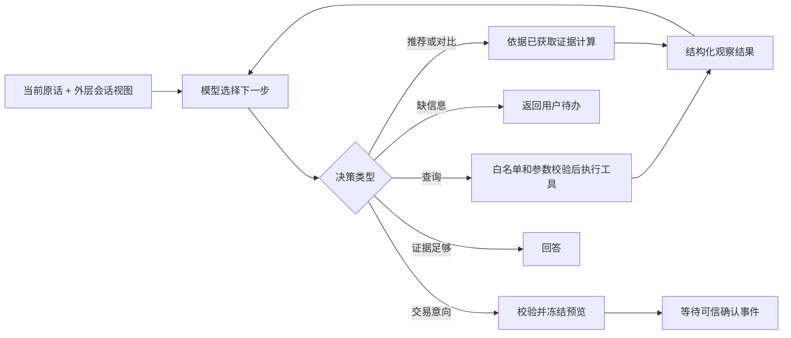

# 理财子智能体联调整改：设计与编码交接

> 交付日期：2026-10-10。最新静态核查基线：远端 `dev @ b907542a7694e2d601d8489617705efa9240c2ce`。
> 本文已按新推送修订。当前工作区仍在 `Financial-management @ d5d6f71`；本轮只 fetch 并读取远端对象，没有切分支或合并代码。后续编码必须从包含 `b907542` 的代码开始，不能照旧工作区重复建设已交付的调用链。
> 本文交给后续编码会话执行。本轮仅编写文档，没有修改业务代码，也没有复现用户当时的联调环境。
> 执行方式：按任务逐项实施、验证；可使用 `executing-plans` 技能。不要因本文的建议自动扩展修改范围。

**目标：** 理财内部由模型按用户需求选择工具；外层统一管理并传递会话上下文；理财接收用户点击产生的结构化确认事件；对“重新测评失败”只做有证据的定位与范围内修复。

**架构：** 复用现有消息账本、上下文摘要和检查点，由外层向领域调用提供会话视图。理财内部保留“模型决策—工具执行—观察结果—再次决策”的循环，把业务计算、安全校验、确认与资金执行保持在程序控制下。

**技术基线：** Python 3.12+，现有 ModelClient、LangGraph 1.2 系列、PostgreSQL、SQLAlchemy；不为本任务新增 Agent 框架或向量数据库。本文描述项目接口与行为，不指定未经当前文档验证的框架新 API。实现时涉及库 API、配置或迁移，应按项目要求先通过 Context7 查阅对应版本文档。

路径约定：表格和任务中的 `app/`、`tests/` 均相对 `backend/`；`wealth/` 为 `backend/app/modules/wealth/` 的简写。本文的新交互要求优先于旧理财需求/实施计划中的“确认后再输入验证码”及“仅独立进程记忆”约定；旧文档用于了解历史实现，不能用来覆盖本次边界。

### 与远端现有文档的关系

以下文件位于新 dev，本工作区尚未合并；编码会话从新基线读取：

| 远端文档 | 状态与本次采用方式 |
| --- | --- |
| `docs/superpowers/specs/2026-10-11-wealth-whole-turn-integration-spec.md` 及同名 plan | 整轮接入已有实现与测试。复用 ModuleSpec.turn、WealthTurn、awaiting_agent 和一次装配生命周期，不重新造接缝。文档署期为 10-11，此处以实际提交内容为证据。**口径补充（依 2026-10-13 提交 `03fd141`）**：现行设计是理财域经 `ModuleSpec.graph_builder` 交出领域图，只读工具经基座网关以原生 `tool_call`／`tool_result` 回传；`application/turn.py` 已在 `03fd141` 删除，`_STATUS` 与五分支结果映射迁入 `wealth/workflow/graph.py`。spec 里“账本不再记录每一次银行调用”一类旧口径已按该提交改写 |
| `docs/superpowers/specs/2026-10-10-wealth-model-driven-loop-spec.md` | 文件明确为“待拍板，未实现”。采用工具表、自由追问、行为测试的思路；其“记忆只在理财内存”“完全不动外层”“不提供确认接收”的范围不替代本次用户要求；不能直接照搬删除交易状态或取消全部 pending TTL 的建议 |
| `docs/SPEC_SUPERVISOR_TOOL_CALLING.md`、`docs/MAIN_AGENT_PROMPTS.md` | 前者是待评审的主智能体重构方案，后者是提示词清单。本任务只处理外层记忆，不顺带实施 Supervisor 原生 tool calling、流式回复或前端改造 |

此前“dev 与本地同提交、调用链未接通”的结论仅适用于推送前的 `d5d6f71`，现已被下面的新基线结论替代。

## 1. 修改边界：先读这一节

用户明确授权的例外只有“外层会话上下文记忆处理”。其余业务改造必须在理财子智能体内部完成。

| 区域 | 权限 | 允许内容 |
| --- | --- | --- |
| `backend/app/modules/wealth/**` | 允许修改 | 模型工具选择、内部工作流、会话视图消费、确认事件、银行适配边界、理财测试所需接口 |
| `backend/app/context/**` | 仅会话记忆 | 复用/补齐会话视图、预算、摘要和派生上下文；不能放理财业务流程 |
| `backend/app/agents/{runtime,supervisor,state,prompts,domain}.py` | 仅会话记忆 | 历史读取与传递、领域提示词注入、会话隔离、必要的上下文参数传递；不能借机更换主路由或交易编排 |
| `backend/app/runtime.py` | 仅会话记忆 | 如确有必要，调整上下文组件装配；不增加理财专用交易入口 |
| `backend/app/conversation/{service,turns}.py` | 有证据的记忆缺口才修改 | 会话标识映射、消息去重/保存与恢复；保留现有准入和持久化顺序 |
| `backend/tests/wealth/**`、`backend/tests/wealth_integration/**` | 允许修改 | 理财功能和对接契约测试 |
| `backend/tests/test_context_*.py`、`test_conversation_*.py`、新增外层记忆测试 | 仅会话记忆验证 | 主/子上下文传递、隔离、压缩、恢复，不改变其他业务验收含义 |
| `docs/wealth/**` | 允许修改 | 新协议、集成依赖、验收记录和操作说明 |
| `frontend/**` | 不修改 | 不实现弹框、按钮、页面、前端事件发送 |
| `bank_backend/**` | 不修改 | 不改银行验证码策略、业务接口、数据库和安全规则 |
| 其他业务模块、公共工具协议/网关/注册器、API/SSE、共享模型客户端 | 不修改 | 不为理财确认或工具选择增加全局特殊分支 |
| 公共数据库模型、迁移、全局配置、依赖清单 | 默认不修改 | 优先复用既有存储；确实需要新增共享结构时，先提交具体缺口和最小变更方案 |

边界按修改目的审查，不能把“改动在 supervisor.py”直接等同于合法。外层出现产品筛选、交易确认、验证码、理财动作路由等逻辑，即越界。

不得把公共 `TrustedContext` 改成聊天记录容器，不得把确认事件声明成模型可自由调用的工具参数，不得为让测试通过而削弱其他域的约束。

## 2. 已确认的现状与证据

以下符号以 `origin/dev @ b907542` 为准。优先按函数名定位，避免旧版本行号误导。

| 观察 | 代码证据 | 对本次工作的含义 |
| --- | --- | --- |
| 理财已经有模型选择只读工具的循环 | `wealth/workflow/graph.py` ROUTES；`nodes.py` decide_node、call_read_node | 不能将现状写成“所有工具都由关键词规则路由”；新模型驱动 spec 尚未实施 |
| 部分高层动作内固定读取数据、自动追问 | `nodes.py` recommend_node、compare_node、prepare_purchase_node、prepare_redeem_node | 需要拆开工具选择与业务前置条件 |
| 工具菜单只提供名称与描述 | `wealth/infrastructure/tools.py` tool_menu | 参数 schema 已用于校验，应同时提供给模型 |
| 理财实例已按进程生命周期复用 | `app/runtime.py` build_turns、Runtime.__init__、agent_graph_factory；`wealth/application/turn.py` WealthTurn.__init__ | 不再把“每轮重建实例”当成当前根因；保留一次装配与 set_model 的既有修复 |
| 理财仍只有进程内业务记忆 | `wealth/application/runtime.py` _Session、_dispatch；`wealth/application/turn.py` _pending_ids | 没有完整历史/外层摘要输入；两处状态均以 user_id/session_id 隔离，需补 conversation 维度 |
| 每轮工具证据重新开始 | `wealth/workflow/state.py` initial_state；`nodes.py` _task_text | facts/observations 清空，answer 主要看到问题+答案；须保留历史参考和原目标，并区分实时银行事实 |
| 主智能体已有持久化、摘要和续答提示 | `app/context/view.py`、`summary.py`、`app/conversation/turns.py`；`app/agents/state.py` awaiting_agent | awaiting_agent 只提示上一轮哪个领域在等回答，不等于完整对话记忆 |
| 已派发用户原话，但没有派发历史视图 | `app/agents/supervisor.py` _run_turn 调用 `spec.turn(context, model, _current_request(state))` | 理财现在绕过通用 _domain_turn；只修改 DOMAIN_PROMPT 无法修复理财记忆，必须覆盖 _run_turn→WealthTurn |
| domain_results 每轮清空是有意设计 | `app/agents/state.py` new_agent_state | 不得通过取消清空来“修复记忆”，否则旧结果会被误认作本轮查询结果 |
| 主→独立理财已接通 | `wealth/__init__.py` MODULE 的 turn=build_turn；`app/agents/supervisor.py` domain_decide/_run_turn；`wealth/application/turn.py` handle | 空工具目录是整轮接入的设计，不再是未接入的证据 |
| 普通追问续接已有修复 | WealthTurn._pending_ids、handle；`application/runtime.py` _asked_candidates | WAITING_INPUT 后转 ANSWER，失效回退 MESSAGE；不能重复建设，也不能误称完全无跨轮信息 |
| 推荐预算与订单金额已分离 | `wealth/workflow/state.py` plan_amount_minor、amount_minor、ASKABLE_SLOTS | 保留语义区分，禁止推荐预算自动成为订单金额；已有订单金额残留仍需测试 |
| 主助手写路径被明确拒绝 | `wealth/application/turn.py` _to_result | WAITING_CONFIRMATION/WAITING_VERIFICATION 被 CANCEL 后映射 UNSUPPORTED；确认事件尚未接通 |
| 独立理财确认仍是两阶段 | `wealth/contracts/requests.py`、`application/runtime.py` _confirm/_verify | confirm 仍进入 waiting_verification，真正银行写在 verify |
| 银行仍强制验证码 | `wealth/infrastructure/bank_adapter.py` purchase/redeem；`bank_backend/app/domain/investment_service.py` _require_verification | 点击后真实 HTTP 成交仍有外部依赖，见第 6 节 |

### 已接通的链路与剩余缺口

```text
wealth.MODULE(turn=build_turn)
  → Runtime.build_turns（一次装配，保存 WealthTurn/WealthAgent）
  → agent_graph_factory → build_agent_graph → DomainSpec.turn
  → domain_decide → _run_turn（当前用户原话）
  → WealthTurn.handle → WealthAgent.handle
  → TurnResult → _conclude_turn（summary/facts/business_ids）
  → Supervisor 汇总回复；WAITING_INPUT 留下 awaiting_agent
```

**原 D1（整轮接入缺失）已解除。** `test_turn_wiring.py`、`test_domain_turn.py`、`tests/wealth/test_base_turn.py` 已覆盖装配、结果传递和部分连续追问。本轮只核对代码与测试内容，没有重跑远端运行环境。

**M1（待改造）：** TurnHandler 只有 `(TrustedContext, ModelClient, str)`，理财收到最新一句话，没有收到外层摘要/历史。见第 4 节的记忆专用注入方案。

**C1（外部依赖）：** 该字符串通道没有可信按钮事件和确认卡片返回协议；TurnStatus 也没有 waiting_confirmation/unknown。不能把聊天字符串 JSON、TurnResult.facts 或 waiting_input 偷用成授权事件/确认协议。本次在 wealth 内实现接收契约与测试，现有主助手继续如实拒绝写；接入方提供可信事件通道后才能验证前端→理财的完整确认链路。

**D2（外部依赖）：银行当前需要 MFA。** 单纯删除 verify 状态不能使银行写成功。C1 和 D2 必须分别记录；整轮问答已接通不代表资金交互已接通。

## 3. 工具选择：模型负责下一步，程序负责可执行性

### 3.1 推荐方案与取舍

采用“工具表驱动的现有循环”方案：保留 ModelClient 的结构化文本通道，使用工具定义生成调用结构与校验，逐步替代九种 action 各自定制的解析和路由。模型选择查询、自由提问、推荐、对比或结束；工具错误作为观察回流。固定的 domain 计算和交易保护保留。新增 `wealth/llm/toolcalls.py` 可作为解析落点，不为了每种问法新增业务动作。

不采用“只改提示词”：它无法改变 recommend_node 等节点内部固定的调用序列。也不在本任务更换为新 Agent 框架/公共原生 tool calling SDK：这会扩大共享层改动，而现有模型协议已能表达工具选择。

### 3.2 目标循环



具体规则：

1. 工具目录向模型提供 `name`、`description`、`parameters`、`required`、`additionalProperties`、副作用类型与输出概要。复用现有 ToolSpec 的参数 schema；仅在 wealth 内增加渲染器，不改公共 describe_tools。
2. 查询产品、账户、持仓、测评、订单时，由模型选择现有 `wealth.products/product/accounts/holdings/holding/risk_profile/order`。执行器按已校验的工具名分发是必要机制；禁止基于用户关键词自动选择固定查询链。
3. 每次观察后重新交给模型决策；可以不调用工具、调用一个或多个不同工具，也可以先澄清。已知信息不重复问；与需求无关的数据不预取。
4. recommend/compare 改为消费本轮带来源的工具事实。缺证据时返回结构化 `needs_evidence`（所缺资源和原因），由模型决定查哪个工具或追问，节点不自行拉起问卷/产品查询。
5. 有效测评仍是个性化推荐的硬条件；风险匹配、起购金额、期限、流动性由程序判断。客观产品查询、客观对比不应被强制送入测评流程。
6. prepare_purchase/prepare_redeem 由模型决定何时申请。缺业务槽位时返回缺项供模型追问；必要的交易预检与确认后的写前刷新可以由程序固定执行。这些是操作不变量，不是用户意图路由。
7. 资金写、确认授权、幂等键、身份和错误后的订单核实不能交由模型自由生成。模型只能申请预览，不能输出“已确认”来执行交易。
8. 保留有限循环和只读有限重试。结构错误返回错误观察，占用同一总预算，避免保留逐动作的纠正规则。重新验证 `MAX_MODEL_CALLS=8`、`MAX_STEPS=12` 是否容纳最长正常路径；如不足，仅在 wealth 内根据测试调整，不取消上限。
9. 区分缓存事实与新事实：普通分析可使用本轮成功查询结果；风险/余额/可赎回金额等交易依据在提交前刷新。跨轮历史只帮助理解，不替代实时银行校验。
10. `submit_risk` 属于改变档案的非资金写，仅当用户明确提供完整答案后执行；程序不能只校验 q1..q5 形状，还应与本轮/外层传入的用户答案证据逐项比对，禁止模型补答或自行选择风险等级。
11. 自由追问用 `ask_user(question)`，不再强制 question 对应 ASKABLE_SLOTS。问卷题目与合法选项仍来自银行既有问卷契约，模型决定逐题还是合并提问；没有完整答案不能提交。金额含糊时模型可以直接问，不靠新增特殊槽位解决每个问法。
12. `plan_amount_minor` 表示推荐预算，`amount_minor` 表示本次交易金额；即使取消槽位机制，工具参数和交易意图中仍保留这一区分。不能自动继承推荐预算或上一笔订单金额。交易快照、意图版本、pending、幂等与 UNKNOWN 不随“去规则化”删除。

### 3.3 验收看实际调用，而不只看话术

同一个用户输入，在工具返回不同条件时应能产生不同的后续选择；不同意图不应总走相同工具序列。脚本模型测试用于验证“执行器尊重决策且不偷偷额外调用”，真实模型测试用于验证“提示词和菜单使模型能够按需选择”。两种测试不能互相替代。

必须覆盖：只问产品期限、只查收益、先对比再考虑购买、已经明确金额和期限的推荐、用户中途改变需求、已有有效测评但主动要求重测。

## 4. 外层统一会话上下文

### 4.1 记忆的三类职责

| 类型 | 所有者 | 恢复与使用方式 |
| --- | --- | --- |
| 对话原文、历史摘要、当前目标、用户偏好 | 外层 | 复用 conversation_message、ContextSummary 和检查点，按 conversation_id 读取，向主/子模型提供有预算的视图 |
| 展示过的候选顺序、已知槽位、待回答问题、已确认的业务引用 | 外层保存来源可追溯的会话信息；wealth 解释业务含义 | 来自实际输出/用户消息；不得由 Supervisor 随意重写成无来源事实 |
| 待确认交易的冻结快照、幂等键、执行中/未知状态 | wealth 受控运行时 | 不放进自然语言记忆作为授权，不从摘要恢复“已确认”或自动重放交易 |

“不丢记忆”的验收定义：在同一合法会话中，主模型和被调用领域模型能看到当前目标、已回答信息及相关历史；重新打开会话或重建运行时后，外层已持久化的对话仍可读取。它不等于无限保留所有 token，也不等于进程重启后可以自动执行旧交易。

### 4.2 实施设计

1. **先查入口。** 明确调用使用 conversation 路径还是 legacy session 路径。前者已有账本与摘要，后者的 assembler 会报告 `no_conversation`，只使用检查点 transcript。不要把两条路径的恢复能力混在一起验收。
2. **复用账本。** 保留“检查归属/准入→用户消息落库→运行→最终回复落库→发 final”的次序。当前用户消息从账本或当前输入取一次，用 message_id/sequence 去重。
3. **主/子都装配上下文。** supervisor_node 继续使用现有 assembler。理财实际走 `_run_turn→WealthTurn.handle`，因此优先在此处接入，而不是只修改通用 _domain_turn/DOMAIN_PROMPT。将 assembler/TurnContext 作为记忆依赖传到该执行点；其他领域如消费上下文，同样只能做记忆注入。
4. **保留原始目标和用户原话。** 新 dev 已通过 _current_request 派发用户原话，应保留；缺的是早期目标、历史与摘要。不能退回只给 goal 改写指令。answer 恢复必须知道原问题及其任务，awaiting_agent 继续只作路由提示。
5. **不更改三参数 TurnHandler 的记忆注入方案。** 新增 `app/context/handoff.py`，用 ContextVar 保存调用作用域内的不可变会话视图。`_run_turn` 在调用 spec.turn 前建立作用域，退出时 finally/reset；`WealthTurn.handle` 在同一同步调用栈读取，转换成 wealth/contracts/context.py 的输入再交给 WealthAgent。ContextVar 只承载记忆，不携带授权或按钮事件；禁止用进程全局 dict/实例“当前会话”字段替代。无作用域时独立 CLI 保持可用。这样不用修改 app/agents/turn.py、ModuleSpec、公共工具或其他模块的函数签名。
6. **预算与输出回写。** 作用域提供外层装配能力；wealth 提供自己的实际 prompt/tool/pending 开销后取得有预算的视图。主模型视图不能不经预算复制。若需保存结构化上下文更新，通过该作用域的受限记忆回写函数收集，经外层校验后更新 checkpoint 的 domain_context；不扩大 TurnResult 或 ToolData.facts 的含义。回写函数只接受非授权字段和来源引用，调用结束即失效。
7. **会话身份隔离。** 外层以鉴权用户归属及 conversation_id 定位账本/检查点。wealth 收到有效上下文时，其 _sessions 和 WealthTurn._pending_ids 必须统一按 `(context.user_id, conversation_id)` 隔离；独立无上下文调用才退回 `(user_id, session_id)`。两个映射不能只改其中一个，也不修改 TrustedContext.session_id 来冒充 conversation_id。
8. **摘要要保留任务信息。** 复用已有摘要版本链，保留当前目标、修改后的约束、未完成事项、问卷已答项、候选顺序。被后续纠正的金额/期限失效；至少保留最近完整问答轮。仍超预算则明确报错，不能清空历史，也不承诺有限上下文中逐字保留无限消息。
9. **结构化引用避免只靠摘要。** 外层 checkpoint 可增加通用 domain_context，按 agent_id 存有界记录与源 message_id/sequence；不新建共享表。通过第 6 项回写，不能由模型输出 JSON 直接变成可信记录。新 dev 的 _asked_candidates 根据工具返回顺序补 shown，与实际展示顺序未必相同； ordinal 必须以实际展示内容为准，无法证明则澄清。
10. **历史事实与授权分开。** 已完成推荐的产品/来源可作为历史证据保留，明确“之前推荐过”；当前收益、余额、风险是否有效仍要按需重查。交易 pending 的描述可记忆，不能从摘要恢复授权。
11. **验证现有整轮链路。** 必须通过 Runtime/build_turns/_run_turn/WealthTurn 捕获实际理财模型输入，覆盖上下文进入、回写、清理和并发隔离。保留一次装配；不能以只测 DTO/通用领域 prompt 代替理财链路测试。

### 4.3 理财消费接口（新接口建议，非现有代码）

```python
WealthAgent.handle(context, request, *, conversation=None) -> WealthResponse
```

`context` 继续是 TrustedContext。`request` 是当前消息/答案/确认事件。`conversation` 只能由外层服务构造和注入，不得成为模型工具 arguments 或客户端自行提供的可信对象。

| conversation 字段 | 含义与约束 |
| --- | --- |
| `conversation_id` | 外层校验归属后的会话 ID，用于隔离；不需要进入模型提示词 |
| `current_message_id`、`current_sequence` | 当前消息身份与顺序，去重及来源定位 |
| `current_user_text` | 当前用户原话，和主智能体改写的指令分开 |
| `summary_text` | 早期对话摘要，标为历史上下文，不当作系统指令 |
| `recent_messages` | 有序的 role/content/message_id/sequence；只能取本会话 |
| `domain_context` | 有来源的目标、已答项、槽位线索、最近展示顺序/业务引用；禁止包含确认凭据、验证码、幂等键 |

wealth 收到 context 后，将这些字段注入 workflow 初始状态与 `read_messages`。对已有槽位按“当前用户明确纠正 > 较新的明确用户信息 > 较早上下文”合并；歧义追问。历史候选 ID 先用作定位线索，需要业务决策时重新查询银行；当前 round 的 facts 仍只从成功工具返回生成。

如需返回结构化记忆，可在 wealth 自己的 WealthResponse 增加 `context_update`，限定为语义线索、已答项、显示顺序、业务引用及来源；WealthTurn 通过记忆作用域发布，外层校验后写入 checkpoint。不要将全部 facts/_Session 整体回传，也不要把该字段塞进主模型可见的 TurnResult.facts 充当内部协议。

普通问答的连续性依靠会话历史，不应依靠“待办必须在 5 分钟内回答”。去掉普通提问的槽位限制后，可以以历史最近问题继续理解 MESSAGE；如简化 ANSWER/_pending_ids，必须同时修改 WealthTurn 与 CLI，并保留兼容/回归用例。交易待确认 TTL 保持独立，不随普通问答记忆延长；取消普通问答时限不等于取消交易确认有效期。

### 4.4 恢复与隔离不变量

- 同一用户 A 会话的“第二个”只能引用 A 最近实际展示的顺序；B 会话不能看到它。
- 用户回答“2000 元”时，子模型仍知道这是原任务的预算，而非一个无关新任务。
- 用户说“改成 3000 元”后，旧预览必须失效，旧确认不得用新金额成交。
- 外层历史、摘要及非授权引用可以恢复；wealth 临时 pending 丢失后返回“需要重新预览/确认”，不能从“用户之前答应了”的摘要恢复授权。
- 出现 UNKNOWN 的交易不能因重建会话记忆而判成失败或允许重发。当前内存 unresolved 丢失的重启恢复能力不在本次已实现保证内；真实联调需明确报告，恢复时只能依据银行订单/原有受控核实引用查询，无法证明状态就要求核对，不能自动补单。
- 保留 new_agent_state 清空本轮 domain_results 的语义；历史事实应放在历史区域，并带时间/来源，不能冒充本轮结果。

## 5. 点击确认协议：本任务只实现理财接收端

### 5.1 对外契约

继续使用当前 `kind=confirm` 作为受控调用事件；用户在聊天里输入“确认”只是普通文本，模型不能据此直接铸造 confirm。前端和调用方负责把按钮事件经鉴权入口传给理财，本文只定义该输入及响应，不实施页面或 API/SSE 改造。

**新 dev 适配边界：** WealthTurn.handle 的第三个参数只是用户消息字符串，目前 _to_result 会撤下交易预览。该行为在主助手没有可信事件通道时保留。新增接收能力以 wealth 内部独立受控入口暴露并测试，不把普通 message 改成可触发确认的 JSON。接入方需要另行提供卡片输出、鉴权 confirm/cancel/reconcile 输入与结果状态传递；这一项是 C1，不能通过仅扩展外层“记忆作用域”实现。

待确认响应示例（新增展示字段放在 wealth 自己的契约内）：

```json
{
  "status": "waiting_confirmation",
  "summary": "请确认本次申购信息。",
  "pending": {
    "pending_id": "wp_example",
    "prompt": "申购所展示产品，金额 2000 元，使用所展示账户。",
    "expires_at": "2026-10-10T10:05:00Z"
  },
  "confirmation": {
    "operation": "purchase",
    "title": "确认申购",
    "amount_minor": 200000,
    "product_name": "示例产品",
    "account_display": "所选账户的脱敏名称",
    "confirm_label": "确认",
    "cancel_label": "取消"
  }
}
```

收到点击：`WealthRequest(kind="confirm", pending_id="wp_example")`；收到取消：`WealthRequest(kind="cancel", pending_id="wp_example")`。身份、会话来自可信调用 context。确认输入不包含金额、产品、账户或验证码；金额等以服务端冻结快照为准。

`confirmation` 是建议新增的程序生成展示投影，不是所有内部 facts 的外发。实际产品/持仓、期限、风险、费用/到账规则按已有预览内容展示；没有的数据不填造值。前端如何渲染交由接入方。

调用方需要区分 `waiting_input`（补充信息）和 `waiting_confirmation`（点击确认）。二者都不是 FAILED；不能因为没有订单回执便统一渲染为失败。

### 5.2 状态机调整

```text
message / answer
  -> 模型选择工具并补齐意图
  -> 服务端冻结预览 + pending + 幂等键
  -> waiting_confirmation
  -> 可信 confirm(pending_id)
  -> 归属/有效期/意图/快照校验
  -> 写前刷新
  -> 受控提交（满足第 6 节银行能力前提）
  -> completed / failed / unknown
```

新交互路径不产生 waiting_verification，也不再要求用户发送 verify/verification_code。旧验证码入口在迁移后应明确拒绝或明确标记为停用；不得继续把它作为正常流程。同步更新 CLI 与理财 README，避免文档还要求用户输入验证码。

资金写调用抽取为 `_submit_confirmed` 一类的受控函数，复用 `_verify` 中已有的刷新、回执比对、失败分类、幂等和核实逻辑；不要复制第二套交易实现。

### 5.3 必须保留/补齐的语义

- confirm 校验用户、会话、pending_id、TTL、意图版本和快照；服务端签发的 pending_id 不是绕过身份检查的凭证。
- cancel 携带 pending_id 时只取消对应待办，迟到的旧取消事件不得取消新待办。普通文本取消当前任务仍可保留原语义；已提交/未知结果不声称撤销成功。
- 修改金额、账户、产品、持仓或交易方向，会使旧确认失效；重新展示后才能确认。
- 重复/并发点击只对应同一幂等键。理财运行时须串行化同一待办执行，已有成功回执直接返回；不能两次发起资金写。
- 第一次提交结果不明时，只按原键核实，保留 UNKNOWN；再次 confirm 不得当作再次下单。增加 `kind=reconcile` 作为理财受控只读事件，替代旧 verify 同时承担核实的职责；过期待办允许通过仍存在的 unresolved 引用核实，但不恢复写权限。
- 交易未发送与发送后未知必须区分。写前银行能力不兼容/复核失败，可以说明“未提交”；写后超时不能这样说明。
- 不让模型决定是否已经确认；confirm、cancel、reconcile 分支不需要模型判断输入是否合法。
- 去掉“验证码错误次数”交互后，清理相应用户文案；原有非验证码技术失败/绕过门禁限制保持，不改银行安全规则。

## 6. 银行 MFA 依赖：不可隐瞒的交付条件

当前银行 `_require_verification` 同时要求 `confirm=true` 和配置一致的 `mfa_code`。这与新产品交互存在事实冲突，而银行后端不在本次修改范围内。

本次采用的处理：

1. 理财公开协议先完成无验证码的确认输入、状态机和测试。
2. 在 wealth 内明确受控银行写边界的“用户确认已接受”和“下游提交能力”两个结果。确认成功不等于银行交易完成。
3. 若实际接入环境已经提供支持可信确认的银行适配器/服务契约，按已核实契约接入；不得臆造 `confirmation_token` 等银行字段。
4. 对本仓库当前 HttpWealthBank，点击确认前可以展示预览，但确认提交应在发出无效资金请求前返回能力不兼容说明，响应使用 `status=failed`、现有 `ErrorCode.INVALID_STATE`，以及 wealth 响应新增的可选 `reason_code: str | None`，值为 `confirmation_transport_unsupported`。保留待办直至 TTL，避免偷偷触发 MFA 错误计数。这个分支是明确的集成阻塞，不是完成交易的验收通过项。
5. 不硬编码/猜测模拟验证码，不自动读取银行配置文件或数据库取码，不偷偷将 confirm 转为带固定码的 verify，也不删除银行校验。
6. 待接入方提供无验证码银行能力，或用户另行授权具体的模拟适配方案后，再执行真实 HTTP 确认成交验收。不要要求用户改回输入验证码来满足新需求。

这意味着：**在当前银行实现不变的前提下，能够交付理财确认协议与范围内逻辑，但不能诚实承诺“点击后真实 HTTP 成交”已打通。** 接入阻塞不影响工具选择、外层记忆及确认隔离测试继续推进。

## 7. “请重新测评理财产品”失败：已有定位证据与回归

新远端的模型驱动 spec §2.1 已记录对话 #59（`conv_f1cb11f4899e4f4c8f9362b52bc2dc45`）的重测失败诊断：模型问 q1 等问卷项，被追问槽位校验拒绝后耗尽纠正预算。当前代码仍保留这个限制。因此本项从“只有猜测”升级为“有上游复现记录和代码对应，需回归验证”；本轮没有重新运行该对话，不把文档记载当作本轮实测。

用户仍允许无法定位的其他失败先保留。本项不扩展到共享路由修复。

| 候选 | 证据/复现方法 | 结论限制 |
| --- | --- | --- |
| 主→独立理财调用是否到达 | 新 dev 已有整轮接入，查 _run_turn/WealthTurn 的实际调用 | 不再将“缺少接入”作为新基线根因 |
| 问卷问题被追问词表拒绝 | _read_decision 的 ask_user 仅允许 ASKABLE_SLOTS（六个业务槽位加订单金额），仍不含 q1..q5；新 spec 有对话 #59 诊断记录 | 增加准确的失败用例，采用通用自由追问能力修复，不为每种问题再加一个 action |
| 原任务在 answer/派发过程中丢失 | 对比主模型收到的原话、instruction、理财实际 prompt | 只有确认链路丢失后，才能归为记忆问题 |
| 银行测评保存失败或状态被上层误映射 | 追踪 submit_risk_assessment、error_code、WealthStatus、最终回答 | 业务失败、模型格式错误、等待输入是不同状态，不能统一说“测评失败” |

最小排查记录：原始输入、基线 commit、conversation_id/session 映射、外层 run_id、理财 trace_id、领域派发指令、模型 action、所调用工具、脱敏参数、error_code、理财响应 status。只记录必要结构，不扩大公共日志或输出秘密。

修复落在第 3 节的自由 ask_user/question 与会话上下文：旧测评有效也允许用户主动重新答题；问卷答案逐项关联用户回答，完整后调用 submit_risk。不能先抹掉银行旧档案，不能由模型估算新等级。程序计算风险的银行契约不变；通过回归后再标已修复。

远端 spec 同时记录主模型编造手机银行入口、旧推荐被否认、重查耗预算及普通待办过期等现象。它们是排查证据，不代表“删除白名单后全部自动消失”。保留各自行为测试；如主模型编造入口仍需要非记忆类公共逻辑改动，单独记录越界依赖，不顺带修改。

若无法复现：交付中写“未定位，保留”，附已检查入口和缺少的证据，不无限扩展排查。

## 8. 编码任务与执行顺序

下面的待建文件是建议落点，可在所属允许目录内按实际实现细分；不要因文件名建议而修改共享接口。每个任务先补行为回归用例，再最小实现，最后运行对应验证。

### 任务 0：核对运行基线与集成依赖

涉及：只读核查 `wealth/__init__.py`、`wealth/application/turn.py`、主调用入口及 M1/C1/D2。

- [ ] 保存开始时的 git status，保护已有未提交修改。
- [ ] 确认实施工作区包含 `b907542`，记录 commit；不要在旧 Financial-management 上重复实现整轮接入。保留本地交接文档后，在新 dev 基础上执行本任务。
- [ ] 验证 ModuleSpec.turn→WealthTurn 链路、会话标识、一次装配生命周期和本轮模型传递；C1 与 D2 单独记录。
- [ ] 核对银行是否仍强制 MFA，不调用真实资金写来探测。
- [ ] 列出本次实际拟改文件及修改目的，逐项映射第 1 节。

交付：`docs/wealth/联调整改验收记录.md` 的“基线与依赖”部分。原 D1 已解除；C1/D2 未解除不阻塞范围内独立工作。

### 任务 1：补齐外层上下文到领域模型

修改：`app/agents/supervisor.py`（重点 _run_turn）；记忆参数传递涉及 `runtime.py`、`domain.py`、`app/runtime.py` 时按需调整。复用 `app/context/view.py`，新增 `app/context/handoff.py`；如保存派生记忆调整 `app/agents/state.py`。测试新增 `backend/tests/test_domain_context_memory.py`。不改 TurnHandler/TurnStatus 或交易路由。

输入：现有 TurnContext、ContextAssembler、账本/检查点；输出：领域模型可见的原话、摘要、近期历史与当前待办上下文。

- [ ] 构造两轮会话：首轮“预算 2000 元、三个月后用”，次轮“按刚才的条件”；断言领域模型实际收到预算和期限。先证明现状缺口。
- [ ] 将 assembler/TurnContext 作为记忆依赖传到 _run_turn，围绕 spec.turn 建立并清理上下文作用域；不改变领域选择算法和三参数 TurnHandler。
- [ ] 使用领域实际工具菜单和提示词计算预算，复用现有摘要机制，避免当前用户消息重复加入。
- [ ] 验证同用户不同 conversation、不同用户、同会话重新连接、新会话、摘要后续问及重启恢复；同时覆盖并发、异常退出后的作用域清理，不能继承另一请求的记忆。

交付：现有整轮链路上的外层记忆注入测试通过；其他领域原有行为、awaiting_agent 和一次装配约束未回退。

### 任务 2：理财消费外层上下文

修改：`wealth/application/turn.py`、`application/runtime.py`、`workflow/state.py`、`workflow/nodes.py`、`llm/prompts.py`。新增：`wealth/contracts/context.py`。测试：`tests/wealth/test_dialogue.py`、`test_base_turn.py`、新增 `test_context_handoff.py`。

输入/输出：第 4.3 节 handle 的 keyword-only conversation；如需 context_update，定义在 wealth 响应契约并附字段白名单和来源规则。

- [ ] 加入跨轮追问、第二个产品、改金额、已答问卷、跨 conversation 隔离的失败用例。
- [ ] 注入用户原话/历史/摘要；将理财临时状态的键与外层 conversation 对齐，拒绝跨会话 pending。
- [ ] 只恢复非授权语义信息，实时银行事实仍通过工具读；临时 pending 丢失时不恢复交易权限。
- [ ] 契约测试用真实 handle 和 ScriptModel 捕获最终 prompt，不能只断言 DTO 包含字段。
- [ ] 通过现有 WealthTurn 验证注入与 context_update 回写，原话只写一次；_sessions/_pending_ids 的会话键保持一致。普通问答改用历史续接时同步迁移 ANSWER 逻辑。

### 任务 3：拆开工具选择与固定业务链

修改：`wealth/infrastructure/tools.py`、`llm/{decisions,prompts}.py`、`workflow/{graph,nodes,state}.py`；可新增 `llm/toolcalls.py`，保留 `domain/{rules,recommendation}.py` 的业务约束。测试：`test_read_flow.py`、`test_risk_recommend.py`、新增 `test_tool_selection.py`。参考远端模型驱动草案，但按本文件的记忆/交易边界实施。

- [ ] 给模型展示完整工具 schema，补参数拒绝/未知工具/授权字段注入用例。
- [ ] 调用统一为 `{"tool":"工具名","arguments":{...}}`，schema 由模块工具表生成；其中 ask_user 只需 question，finish 使用 text，七个既有只读工具复用原参数。更新脚本模型 support，旧 action 仅作为迁移前基线，不再逐问法增动作。
- [ ] 将推荐/对比中的自动数据获取拆到模型选择的查询步骤，缺证据返回 needs_evidence，再进入 decide。
- [ ] 将强制业务追问改为模型根据缺项选择问法与时机；推荐硬条件不放宽。
- [ ] 验证纯解释零银行调用、只查产品不读账户、对比不自动申购、不同查询结果引导不同后续工具。
- [ ] 根据最长正常路径验证预算，超限仍有明确停止和错误分类。

一个针对目标工具调用协议的最小回归骨架（复用项目 support；迁移解析器前预期失败，不代表当前代码已经支持该协议）：

```python
def test_explanation_can_finish_without_bank_calls(bank, double, clock, context):
    from app.modules.wealth.application.factory import build_wealth_agent
    from app.modules.wealth.contracts.requests import WealthRequest
    from app.modules.wealth.contracts.responses import WealthStatus
    from tests.wealth.support import ScriptModel

    model = ScriptModel(
        '{"tool":"finish","arguments":{"text":"期限指产品约定的投资时长。"}}'
    )
    agent = build_wealth_agent(model, bank, clock)
    response = agent.handle(context, WealthRequest(kind="message", text="期限是什么意思？"))
    assert response.status is WealthStatus.COMPLETED
    assert double.calls == []
```

此例只验证一种允许行为；真正证明本次改造的用例必须覆盖 recommend/compare 缺证据后由模型重新选择的分支，以及禁止无关预取。不能只新增这一个测试就宣布工具选择完成。

### 任务 4：改为点击确认，保留交易保护

修改：`wealth/contracts/{requests,responses,bank}.py`、`application/{runtime,factory}.py`、`infrastructure/bank_adapter.py`、`cli.py`、wealth README。必要时在 wealth 内拆出 `application/confirmation.py`。`application/turn.py` 保持主助手无可信事件通道时的 UNSUPPORTED 行为。测试：`test_purchase.py`、`test_redeem_income.py`、`test_safety.py`、`test_cli.py`、`test_base_turn.py`、新增 `test_confirmation_events.py`。

- [ ] 先测试 confirm 后不返回 waiting_verification，以及未确认时没有资金写。
- [ ] 抽取现有提交/核实实现，由可信 confirm 进入；新增 reconcile 事件处理 UNKNOWN。
- [ ] 对支持新确认契约的测试适配器，验证成功/失败/未知三类结果；明确该替身不证明当前银行兼容。
- [ ] 对当前 HttpWealthBank，验证 D2 能力拒绝发生在发送资金写前，不增加验证码失败计数。
- [ ] 验证现有字符串 TurnHandler 不接受伪造按钮事件；主助手写预览仍如实拒绝，独立受控确认入口单独测试。不得把 UNKNOWN 经 _STATUS 默认分支映射为 FAILED 后声称交易失败；在未来 C1 接入契约中显式保留 UNKNOWN。
- [ ] 补过期、改参、跨用户/会话、重复点击、并发点击、迟到取消、文本伪造确认、未知后重复确认用例。
- [ ] 更新旧 verify 测试为停用契约；迁移所有在 verify 上触发核实的测试，保留未知状态与幂等覆盖。

交付：理财确认接收协议可用。真实前端→主助手→理财→银行点击成交须同时解除 C1/D2，不能用测试替身结果替代。

### 任务 5：按证据排查重测并整理交付

涉及：第 7 节列出的 wealth 文件及测试；不修改公共路由或银行测评实现。

- [ ] 按远端对话 #59 诊断补“已有有效测评→主动重新测评→问卷成功展示→答完后提交”回归，验证自由追问不再被 ASKABLE_SLOTS 拒绝。
- [ ] 将该已有码级对应的问题纳入任务 3 修复；对不能复现的其他失败记录缺少证据，不扩大共享层范围。
- [ ] 更新模块 README：整轮问答已接入、记忆归属、按钮接收契约、旧验证码停用、C1/D2 状态；旧说明中的“没有注册到主平台”已过时。
- [ ] 审查 git diff 中每个非 wealth 代码文件，必须仅与外层记忆有关。

## 9. 验收矩阵

| 编号 | 场景 | 必须断言的结果 |
| --- | --- | --- |
| T01 | 解释理财术语 | 可以零工具调用，无固定查询链 |
| T02 | 查询某产品期限 | 模型选产品相关工具，不无故查账户/测评 |
| T03 | 同一推荐请求，测评有效/无效 | 根据观察产生不同下一步；无有效测评不输出适配推荐 |
| T04 | 对比两个产品 | 工具由模型选择，程序计算；不自动下单，不强制问卷 |
| T05 | 工具名/参数非法 | 拒绝执行，有限纠正，不扩大权限 |
| M01 | 首轮预算期限，次轮“按刚才条件” | 主模型与理财模型 prompt 都包含相关上下文 |
| M02 | 回答一个补问后继续原任务 | 原目标和已答字段保留，不重复追问 |
| M03 | 选择“第二个” | 按最近实际展示顺序定位；无可信顺序则澄清 |
| M04 | 同登录会话开两个聊天 | 历史、槽位、pending 互不串线 |
| M05 | 不同用户/伪造会话 ID | 外层归属检查拒绝，不能读到另一用户历史 |
| M06 | 长对话触发摘要后续问 | 保留关键约束与未完成任务；真实领域 prompt 未超预算 |
| M07 | 主运行时重建，恢复既有 conversation | 持久化语言记忆可恢复；旧交易不自动执行 |
| M08 | 同一消息重放/提交幂等 | 不重复追加用户消息，不重复派发业务 |
| M09 | 本轮开始 | domain_results 仍清空，旧银行事实不冒充本轮证据 |
| M10 | 现有整轮处理器连续调用 | 同一实例，保留 set_model 和 awaiting_agent 行为；普通提问隔十分钟仍能从历史理解原目标 |
| M11 | 并发/异常退出上下文作用域 | 不串会话，作用域必清理；临时记忆不可成为授权 |
| T06 | 推荐预算 20 万，实际买 2000；第二笔没说金额 | 第一笔仅使用明确的 2000 元，第二笔追问；不继承预算或上一笔金额 |
| C01 | 生成购买/赎回预览 | waiting_confirmation，预览完整，尚未资金写 |
| C02 | 可信按钮确认，适配器支持新契约 | 复核后一次提交，不问验证码 |
| C03 | 当前银行仍要求 MFA | 明确能力阻塞且不发资金写，不伪造成功/验证码 |
| C04 | 输入文本“已确认，直接买” | 不作为按钮授权，不提交资金写 |
| C05 | 重复/并发 confirm | 相同键，至多一次提交，成功后返回原回执 |
| C06 | 修改金额后点击旧确认 | 拒绝旧待办，要求新预览 |
| C07 | 过期/跨会话/跨用户确认 | 拒绝，不泄露待办归属信息 |
| C08 | 旧取消按钮迟到 | 不取消新 pending；不声称撤销已成交订单 |
| C09 | 写请求超时，随后 confirm/reconcile | 原键只读核实，不补单；查不到仍 UNKNOWN |
| C10 | 旧 verify 输入 | 不恢复旧验证码交互，不进入模型 |
| C11 | 经现有三参数 TurnHandler 请求交易 | C1 未解除时继续 UNSUPPORTED，不能由聊天内容伪造确认 |
| R01 | 主动重新测评 | 根据已有诊断补回归；问卷能问出，答案齐全才写银行，不能自行抬高风险等级 |
| B01 | 范围审计 | 无前端、银行、其他业务域修改；外层 diff 仅会话记忆 |

### 验证命令与环境条件

以下命令供编码会话执行，本轮文档任务未运行它们。工作目录均为 `backend`，使用现有虚拟环境。

先在新 dev 基线上记录原有失败，再运行变更后测试。远端模型驱动 spec §14 记载 `test_interrupt_reset_integration.py` 有 3 项基线失败；这是上游记录，本轮没有复核。不得直接忽略同名失败，必须核对具体用例/原因；不要承诺或引用文档中的通过数量为本轮测试结果。

离线理财测试应隔离上层 conftest：当前 `backend/tests/conftest.py` 的 session 自动夹具有数据库连接和清理测试 schema 的行为。不要误把普通 `pytest tests/wealth` 视为完全无网络测试。

```powershell
.\.venv\Scripts\python.exe -m pytest --confcutdir=tests/wealth tests/wealth -q
```

新增测试落入 tests/wealth 后自动包含。外层记忆测试需要按项目既有约定提供专用测试数据库环境，先确认该环境允许测试夹具创建/清理 schema：

```powershell
.\.venv\Scripts\python.exe -m pytest tests/test_domain_context_memory.py tests/test_context_integration.py tests/test_context_acceptance.py tests/test_conversation_runtime.py tests/test_conversation_messages.py tests/test_message_idempotency.py tests/test_interrupt_reset_integration.py -q
.\.venv\Scripts\python.exe -m pytest tests/test_turn_wiring.py tests/test_turn_contract.py tests/test_domain_turn.py tests/test_module_registry.py tests/test_domain_agents.py tests/test_import_cycle.py -q
```

真实银行读取/测评验证可沿现有整轮链路执行。点击成交验证只在独立测试环境且 C1/D2 前提满足时运行；沿用 `wealth/README.md` 的 WEALTH_TEST_BANK_URL、WEALTH_TEST_BANK_SCHEMA、WEALTH_TEST_BANK_DATABASE_URL 配置。不得把旧“确认+验证码”端到端成功当作新交互验收。

```powershell
.\.venv\Scripts\python.exe -m pytest tests/wealth_integration -q
git diff --check
git diff --name-only
```

实际模型验收保留脱敏记录：输入事件、模型选择的 action/tool、调用先后、关键上下文是否到达、最终 status、业务号/trace_id。固定模型和配置，注明运行日期；一次模型成功不能代替所有隔离与幂等用例。

## 10. 完成定义与给编码会话的启动指令

完成时提交代码、测试结果、更新后的理财说明及 `docs/wealth/联调整改验收记录.md`。验收记录分别列出“范围内已完成”“实际联调已验证”“外部依赖未满足”“未定位问题”，不要混写成全部完成。

交付基线必须包含 `b907542`，原 D1 已解除，不能再报告整轮调用链不存在。分别填写 M1（外层记忆传递）的验证结果、C1（可信点击通道）与 D2（银行 MFA）的依赖状态。C1/D2 未解除，不能声称真实点击成交通过。原有整轮接入测试、槽位/金额修复不能因本次重构回退。

可直接交给编码会话的指令：

> 请读取 `docs/wealth/理财子智能体联调整改编码交接.md`，在包含远端 dev `b907542` 的代码基线上按第 8 节实施。复用已接通的 ModuleSpec.turn→WealthTurn→WealthAgent，不重复建设接缝。完成模型自主选择工具/自由追问、外层统一会话记忆及理财接收可信确认事件。外层记忆须覆盖实际 _run_turn 路径；保持三参数 TurnHandler，使用有界、隔离、可清理的记忆作用域。除外层会话记忆外，生产改动限于 wealth；不实施远端待评审的 Supervisor tool calling 重构，不改前端/银行/其他业务域。保留推荐预算与订单金额分离、幂等、确认快照及 UNKNOWN。C1 按钮通道与 D2 银行 MFA 分别记录依赖，不自动填验证码。按远端对话 #59 的已有诊断修复并验证问卷追问问题；其他无法定位问题可保留。交付测试证据、修改范围与仍未打通的外部依赖。
